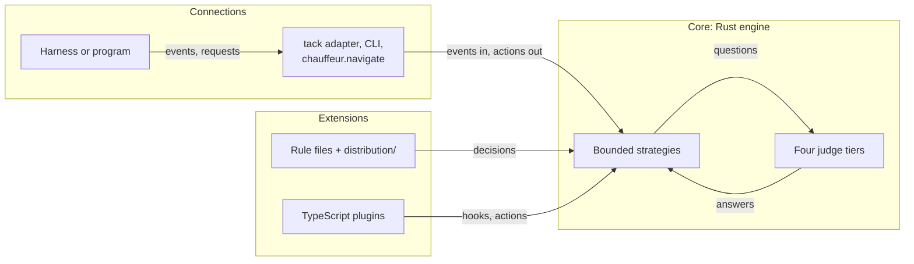
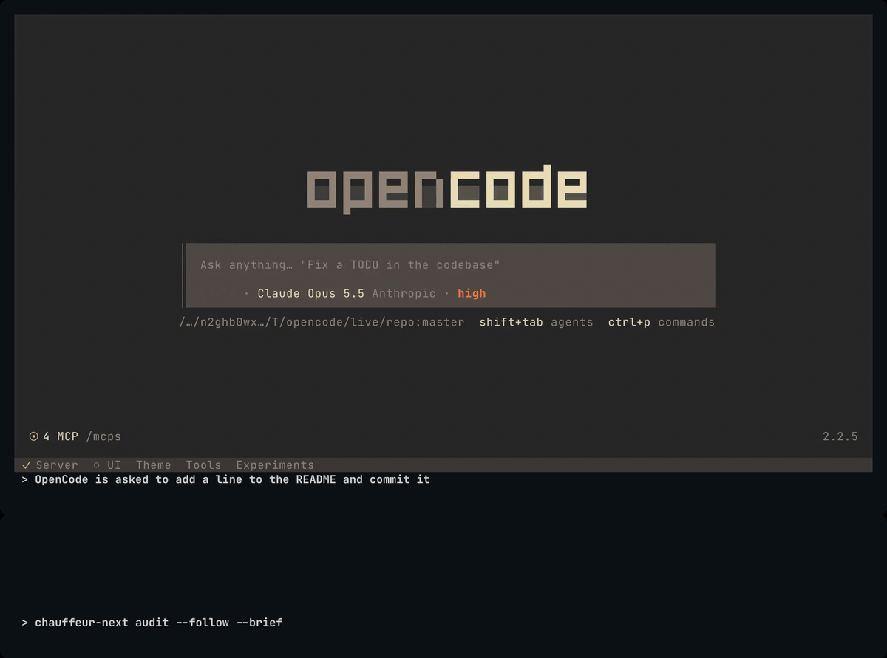

# Chauffeur

Chauffeur watches what your coding agent does and steers it while it works.
When the agent commits with a message such as `fixed stuff`, Chauffeur asks a
fast model whether the message breaks Conventional Commits, and on a confident
yes it asks the agent to amend the commit in the same conversation.

Other programs ask Chauffeur too. sourcefed asks it before each GitHub, Jira
or Slack event reaches your agent, so noise stays out of the session. Every
decision is a rule file you can read and edit, and every run is in an audit
log.

## Design

Chauffeur is a judgment engine with a small Rust core and plugins around it.
A harness or a program sends an event in, the engine runs the rules that match
it, and the actions it returns go back to the caller. Three rings hold the
design.



**Core** is the engine in Rust. It runs bounded strategies: named steps that
each ask one judge one question, in rounds that end at a deadline. Evidence
is redacted before a judge sees it, and a failed judge stays a failure rather
than an answer.

**Extensions** are rule files and the content shipped in `distribution/`.
A rule file names the event it hooks, the question it asks and what to do with
the answer. A TypeScript plugin holds what a rule file cannot — state, work
over time, tools and commands — and acts through generic actions that carry
the session's revision.

**Connections** are one adapter per harness, the CLI, and
`chauffeur.navigate` for any program. tack builds one adapter into each
harness's native form, turning native hooks into Chauffeur's standard events
and its actions back into native calls; sourcefed's triage is a caller of
`navigate`.

A step names one of four judge tiers:

| Tier       | Answers with                                 |
| ---------- | -------------------------------------------- |
| facts      | A sandboxed JavaScript fact, without a model |
| System One | A fast classifier: noul, choice or score     |
| System Two | A reasoning model that cites its evidence    |
| person     | The user, through the adapter                |

The design is in [the v2 plan](https://github.com/wrkhse/chauffeur/issues/43)
and its sub-issues: [plugins](https://github.com/wrkhse/chauffeur/issues/44),
[escalation](https://github.com/wrkhse/chauffeur/issues/45),
[facts](https://github.com/wrkhse/chauffeur/issues/46),
[guards and person steps](https://github.com/wrkhse/chauffeur/issues/47),
[harness adapters](https://github.com/wrkhse/chauffeur/issues/50),
[System Two](https://github.com/wrkhse/chauffeur/issues/51) and
[rulebooks](https://github.com/wrkhse/chauffeur/issues/52).

## Install

The release candidate is `1.0.0-rc.5`. It installs as `chauffeur-next`, with
its own socket, `~/.config/chauffeur-next/` and audit log, so it runs beside
an installed `chauffeur`. Pick your target: `darwin-arm64`, `darwin-x64`,
`linux-arm64` or `linux-x64`.

```sh
version=1.0.0-rc.5
target=darwin-arm64
base=https://github.com/wrkhse/chauffeur/releases/download/v$version
tarball=chauffeur-$version-$target.tar.gz

curl -fLO "$base/$tarball"
curl -fLO "$base/SHA256SUMS"
grep "  $tarball\$" SHA256SUMS | shasum -a 256 -c

prefix=~/.local/opt/chauffeur-next
mkdir -p "$prefix"
tar -xzf "$tarball" -C "$prefix"
mv "$prefix/bin/chauffeur" "$prefix/bin/chauffeur-next"
mv "$prefix/share/chauffeur" "$prefix/share/chauffeur-next"

export PATH="$prefix/bin:$PATH"
chauffeur-next version   # chauffeur-next 1.0.0-rc.5
```

The binary takes its name from its file and finds its shipped rules, models
and OpenCode adapter in `share/<name>/` beside its `bin/` folder, so both
renames matter.

Start the daemon where your Jev key is set. It answers the System One
questions:

```sh
export TYPESAFE_API_KEY=…
chauffeur-next daemon run
```

## Set up OpenCode

Add the adapter's folder to `plugins` in `opencode.jsonc`, as an absolute
path with your own home folder:

```jsonc
{
  "$schema": "https://opencode.ai/config.json",
  "plugins": ["/Users/you/.local/opt/chauffeur-next/share/chauffeur-next/opencode"]
}
```

OpenCode loads the folder's `server.js`. The adapter sends each finished tool
call to the daemon and carries out what the rules return; it writes any
trouble, such as no daemon, to `~/.local/state/chauffeur-next/opencode.log`.

## Example: a commit message that breaks the convention

Ask the agent to commit a change. When its message breaks Conventional
Commits, Jev answers yes, and OpenCode shows Chauffeur's message as one row
after the commit:

```text
◈ Chauffeur · conventional-commits: commit message isn't conventional; asking the agent to amend it
```

The agent reads the full message, which asks for `type(scope): description`,
and amends the commit unless you chose the message. An `unsure` or failed
answer sends nothing.



<sub>Recorded with candidate `1.0.0-rc.3`, in a scratch repository.</sub>

## See what it decided

The audit log keeps every run, and works with no daemon running:

```sh
chauffeur-next audit --follow --brief
```

```text
13:54:43  conventional-commits  s1  nonconventional yes 0.93 jev  312 ms  → message.append
```

`chauffeur-next daemon status` lists the rules the daemon loaded and the rule
files it refused, each with why.

## Try a rule by hand

`emit` sends one harness event, as the adapter does, and prints what the rules
returned:

```sh
echo '{ "event": "tool.after", "session": "s1", "tool": "shell",
        "input": { "command": "git commit -m \"fixed stuff\"" } }' \
  | chauffeur-next emit
```

## Write your own rule

A rule is a JSON file in `~/.config/chauffeur-next/rules/`: the event it
hooks, its judges, the question each step asks, and what to do with the
answer. The daemon loads an edit on the next event. The shipped
[`conventional-commits.json`](distribution/rules/conventional-commits.json) is
a complete one; the grammar is in [`rule`](crates/protocol/src/rule/README.md).

## Ask from a script or a program

A script sends a request on stdin and reads the intents back:

```sh
chauffeur-next navigate <<'EOF'
{ "protocol": 1, "deadline_ms": 3000, "on": "sourcefed.event",
  "evidence": { "event": "thanks, looks good 👍", "monitor": "PR #42" } }
EOF
```

A TypeScript program installs the client from the same release:

```sh
npm install https://github.com/wrkhse/chauffeur/releases/download/v1.0.0-rc.5/fdcn-chauffeur-1.0.0-rc.5.tgz
```

## Filter sourcefed events

With sourcefed installed, `sourcefed setup chauffeur` adds the
`sourcefed/triage` rule, and sourcefed asks Chauffeur before it queues each
event. [sourcefed](docs/integrations/sourcefed.md) has the setup.

## Roadmap

What is left is tracked in
[the v2 plan](https://github.com/wrkhse/chauffeur/issues/43).

- [ ] [Plugins written in TypeScript](https://github.com/wrkhse/chauffeur/issues/44)
- [ ] [Escalation from Jev to a second System One model, image evidence and the
      strategy viewer](https://github.com/wrkhse/chauffeur/issues/45)
- [ ] [Recall for opencode-history, and facts that answer without a
      model](https://github.com/wrkhse/chauffeur/issues/46)
- [ ] [Guards against irreversible commands, permissions and v1's steering
      rules, with plugins](https://github.com/wrkhse/chauffeur/issues/47)
- [ ] [Skills and tools for the agent](https://github.com/wrkhse/chauffeur/issues/48)
- [ ] [Context renewal, session warming and model
      failover](https://github.com/wrkhse/chauffeur/issues/49)
- [ ] [Adapters for Pi, Claude Code and
      Codex](https://github.com/wrkhse/chauffeur/issues/50)
- [ ] [Review by a reasoning model](https://github.com/wrkhse/chauffeur/issues/51)
- [ ] [Rulebooks, held for discussion](https://github.com/wrkhse/chauffeur/issues/52)
- [ ] [Cutover from v1 to `chauffeur`](https://github.com/wrkhse/chauffeur/issues/53)

## More

[CLI](docs/cli/README.md) ·
[Integrations](docs/integrations/README.md) ·
[TypeScript client](packages/chauffeur/README.md) ·
[Moving from v1](docs/migration/README.md) ·
[Crates](crates/README.md) ·
[Playground](playground/README.md) ·
[Docs site](https://chauffeur-docs.stevenjpx2.workers.dev) ·
MIT, see [LICENSE](LICENSE)
