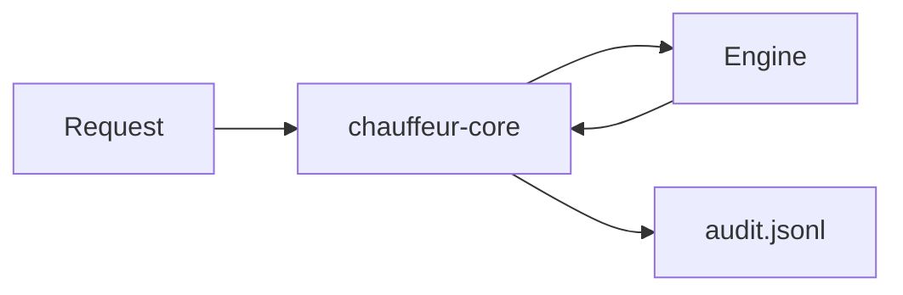

# Chauffeur core



`core/` is an independent Cargo workspace beside the installed chauffeur. It
contains a judgment library and the `chauffeur-core` CLI. The CLI judges a
request and appends the judgment and trace to `audit.jsonl`. At 8 MiB the
file rotates over `audit.1.jsonl`, replacing the older records there, and
a read returns at most the newest 1024 records.

## Judge a request

With `chauffeur-core` on your PATH, pipe a shell request to the CLI:

```sh
printf '%s\n' '{
  "id": "call-1",
  "session": "s1",
  "hook": "tool_before",
  "subject": { "tool": "shell", "input": { "command": "git status" } }
}' | chauffeur-core judge
```

The verdict and trace are:

```json
{
  "request_id": "call-1",
  "verdict": {
    "outcome": "allow",
    "rule": "shell-guard",
    "reason": "literal git status with only plain flags"
  },
  "trace": {
    "events": [
      { "kind": "rule_started", "rule": "shell-guard" },
      {
        "kind": "rule_opinion",
        "rule": "shell-guard",
        "outcome": "allow",
        "reason": "literal git status with only plain flags"
      },
      { "kind": "decided", "rule": "shell-guard", "outcome": "allow" },
      { "kind": "finished" }
    ],
    "dropped": 0
  }
}
```

A hook that calls `chauffeur-core` treats a non-zero exit as deny, so an
invalid request or an unwritable audit log fails closed.

Read the same judgment from the latest audit record. The CLI emits one JSON
line per record; Python formats it here for reading. The `at` timestamp is 20
zero-padded digits of Unix seconds, a dot, and six zero-padded digits of
microseconds. The width is fixed so records sort as text in time order.

```sh
chauffeur-core audit 1 | python3 -m json.tool
```

```json
{
  "at": "00000000001795593150.798529",
  "request_id": "call-1",
  "session": "s1",
  "hook": "tool_before",
  "judgment": {
    "request_id": "call-1",
    "trace": {
      "dropped": 0,
      "events": [
        { "kind": "rule_started", "rule": "shell-guard" },
        {
          "kind": "rule_opinion",
          "outcome": "allow",
          "reason": "literal git status with only plain flags",
          "rule": "shell-guard"
        },
        { "kind": "decided", "outcome": "allow", "rule": "shell-guard" },
        { "kind": "finished" }
      ]
    },
    "verdict": {
      "outcome": "allow",
      "reason": "literal git status with only plain flags",
      "rule": "shell-guard"
    }
  }
}
```

`CHAUFFEUR_CORE_STATE_DIR` chooses the state folder. The default state folder
is separate from the installed chauffeur; choose a separate folder when
setting the variable too.

`shell-guard` is a small demonstration rule, not a complete shell guard.
Luau, tack, model judges, the daemon and a following audit reader are not in
this workspace yet.

## Checks

Run these from `core/`, except the second `nextest` command, which runs only in
CI. The dependency check uses cargo-deny 0.20.2.

```sh
cargo fmt --all -- --check
cargo clippy --workspace --all-targets --all-features --locked -- -D warnings
cargo nextest run --workspace --all-features --locked
cargo nextest run -p chauffeur-cli --test cli --run-ignored only --locked
cargo test --workspace --doc --all-features --locked
cargo deny check
cargo mutants
```

The nine CLI process tests are ignored locally, so the first `nextest` run skips
them; the second command runs them in CI.
