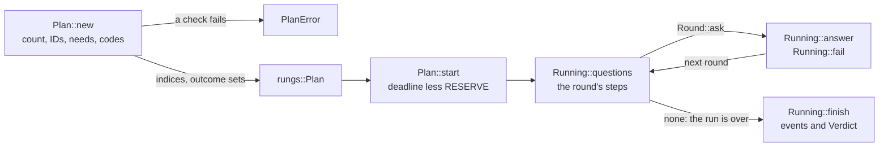

# `plan`

A plan is an ordered list of named steps. Each step asks one question of one
judge, once the earlier steps it waits on allow it: `after` lists needs
that must all hold, `after_any` needs of which one must. A run goes round by
round, and each round asks every step whose needs have come to hold. Core
knows nothing of models: a judge is anything that turns a request into an
`Outcome`.

| File         | Holds                                                                                                                                                                                                                                                                                                                                                    |
| ------------ | -------------------------------------------------------------------------------------------------------------------------------------------------------------------------------------------------------------------------------------------------------------------------------------------------------------------------------------------------------- |
| `mod.rs`     | `Plan`: `new` checks the steps and builds the step machine; `run` drives the rounds against a `Panel`                                                                                                                                                                                                                                                    |
| `step.rs`    | `Step`: an ID, the judge's name, the request, and its `after` and `after_any` needs                                                                                                                                                                                                                                                                      |
| `need.rs`    | `Need` and what it `Wants` of an earlier step: that it finished, or an answer near a `Bar` or listed in `when`                                                                                                                                                                                                                                           |
| `near.rs`    | The near code: whether an answer matches a `Near`, and a value with its matched needs as one machine code                                                                                                                                                                                                                                                |
| `reply.rs`   | `Request` and `Reply`: what core reads of the caller's question and answer                                                                                                                                                                                                                                                                               |
| `build.rs`   | The checks `Plan::new` makes, and the `rungs::Plan` it builds from the steps                                                                                                                                                                                                                                                                             |
| `run.rs`     | `Running`, `Round` and `ReplyError`: the round API, with `RESERVE` and `MIN_ESCALATION`; `Settle`, a code or a failure per step; and `settle_batch`, which settles a round's answers on a copy of the step machine's run, kept only when every step settles, so a reply settles all of its steps or none (proven by Kani in `crates/core/src/proofs.rs`) |
| `outcome.rs` | `Outcome`, a value or a `Failure`, and the five failures with their wire names                                                                                                                                                                                                                                                                           |
| `error.rs`   | `PlanError`: each reason a plan is refused before any judge is asked                                                                                                                                                                                                                                                                                     |



`Plan::new` checks the steps and turns them into a `rungs::Plan`, the step
machine that decides which steps start, which are skipped and when the run is
over. `Plan::start` begins a run. `questions` returns the round to ask,
`answer` and `fail` settle its steps, and `finish` returns the events and
the verdict. `Plan::run` is that loop for a caller with nothing to do between
rounds: it refuses a judge the panel lacks before anyone is asked.

`Plan::new` reserves the exact ID `decision` for the virtual step and refuses
it as a real step ID with `PlanError::ReservedStep`, alongside duplicate-ID
checks. Core exports `DECISION`, the string `"decision"`, from its crate root.

`Running` records the round in which each step opens. `finish` chooses the
decision by the greatest pair of opening round and plan index: a later round
wins, then the higher plan index within that round, regardless of reply or
failure settlement order. Skipped steps never decide. A step that opens and
fails, including one failed by `finish` at the deadline, can decide with
`Outcome::Failed`. If no step opens, there is no decision.

`Verdict::decision()` returns the deciding step's real ID and outcome, and
`get(DECISION)` returns that outcome. `get` of a real ID is its own outcome;
`iter()` and `skipped()` list only real steps in plan order. `Plan::run` uses
the same `Running` path, and the events contain only real steps.

The caller's request says how many values its answer settles to, and its
answer says which one it settled to, with its probability for each outcome in
thousandths:

```rust
struct Ask(&'static str);

impl Request for Ask {
    fn outcomes(&self) -> u8 {
        2
    }
}

#[derive(Clone, Debug, PartialEq)]
struct Said(u16);

impl Reply for Said {
    fn settled(&self) -> u8 {
        u8::from(self.0 < 500)
    }

    fn p(&self, outcome: u8) -> Option<u16> {
        match outcome {
            0 => Some(self.0),
            1 => Some(1000 - self.0),
            _ => None,
        }
    }
}
```

`Ask` is a yes/no question and `Said` its P(yes): outcome 0 is yes, 1 is no.
Here `sure` waits for `fast` to answer within 0.15 of a 0.7 bar on yes, or
to fail:

```rust
let bar = Bar { outcome: 0, at: 700 };
let near = Near::new(150, [bar]);
let unsure = Need::outcome("fast", Some(near), Some(vec![When::Failed]));

let ask = "Does this commit message break Conventional Commits?";
let plan = Plan::new([
    Step::new("fast", "jev", Ask(ask)),
    Step::new("sure", "glide", Ask(ask)).after([unsure]),
])?;

let jev = |_: &Ask| Outcome::Value(Said(800));
let glide = |_: &Ask| Outcome::Value(Said(940));
let panel = Panel::new().with("jev", &jev).with("glide", &glide);

let deadline = Instant::now() + Duration::from_secs(5);
let mut running = plan.start(Some(deadline));

while let Some(round) = running.questions(Instant::now) {
    running.answer(round.ask(&panel))?;
}

let run = running.finish();

assert_eq!(run.verdict.get("fast"), Some(&Outcome::Value(Said(800))));
assert_eq!(run.verdict.get("sure"), Some(&Outcome::Value(Said(940))));
assert_eq!(run.verdict.get(DECISION), run.verdict.get("sure"));
assert_eq!(
    run.verdict.decision(),
    Some(("sure", &Outcome::Value(Said(940))))
);
```

Round 1 asks `fast`; its 800 lies within 150 of 700, so round 2 asks `sure`.
A `Said(250)` from `fast` skips `sure`: the verdict has no outcome for it and
lists it in `skipped()`.

- **Needs.** `Need::settled` holds once its step has finished: settled,
  failed or skipped. `Need::outcome` holds for an answer near one of its bars
  or a value in `when`, and never for a skipped step; a failure matches only
  when `when` lists `When::Failed`. A step with both `after` and `after_any`
  runs only when both hold, and a step whose needs cannot hold is skipped.
- **The near code.** A step read by k near needs settles to one machine
  code, `settled × 2^k + matched`: bit b of `matched` is set when need b's
  bars match the answer, so the machine decides each need from the code
  alone. Probabilities, bars and margins are whole thousandths, which keeps
  the boundaries exact: 850 is within 150 of 700, and 851 is not. A step
  takes at most six near needs, and `Plan::new` refuses one whose codes the
  machine cannot hold with `PlanError::Outcomes`.
- **The deadline.** The steps end `RESERVE`, 1 s, before the deadline given
  to `start`, so the answers in hand return in time. The first round always
  starts; a later round starts only with `MIN_ESCALATION`, 500 ms, left
  before that end, and with less every pending step is skipped. Core keeps
  no clock: the caller passes one to `questions`, such as `Instant::now`,
  and core reads it only before a later round of a run with a deadline, so
  a run without one, such as in WebAssembly, never reads the time. A step
  open at `finish` settles as `Failed(Deadline)`.
- **All or nothing.** `answer` settles every step of the round at once. A
  reply that names a step outside the round, names one twice, leaves one
  out, or that the machine refuses, returns a `ReplyError` and leaves the
  run unchanged: `questions` returns the same round again. `fail` settles
  one open step as failed, and `answer` then covers the rest; `fail_round`
  settles every open step as failed at once. `Plan::run` fails a refused
  round's steps as `Failed(Invalid)`, since `Round::ask` answers each open
  step once and only a judge breaking the machine's rules is refused.
- **Invalid answers.** `Round::ask` asks each judge its share of the round
  in one `judge_all` call. A judge that returns the wrong number of outcomes
  settles each of its steps as `Failed(Invalid)`, never as an answer, and so
  does an answer whose `settled()` is not below its request's `outcomes()`.
- **Fallback.** `Failure::falls_back` says whether a tier's next model
  should answer in its place: unavailable, rate-limited or timed out.
- **Proofs.** Three Kani harnesses in `crates/core/src/proofs.rs` cover what
  core adds to the step machine:
  `a_near_need_matches_only_within_its_margin`,
  `an_outcome_index_decodes_to_its_answer_and_near_matches` and
  `a_reply_settles_all_of_its_steps_or_none`.
