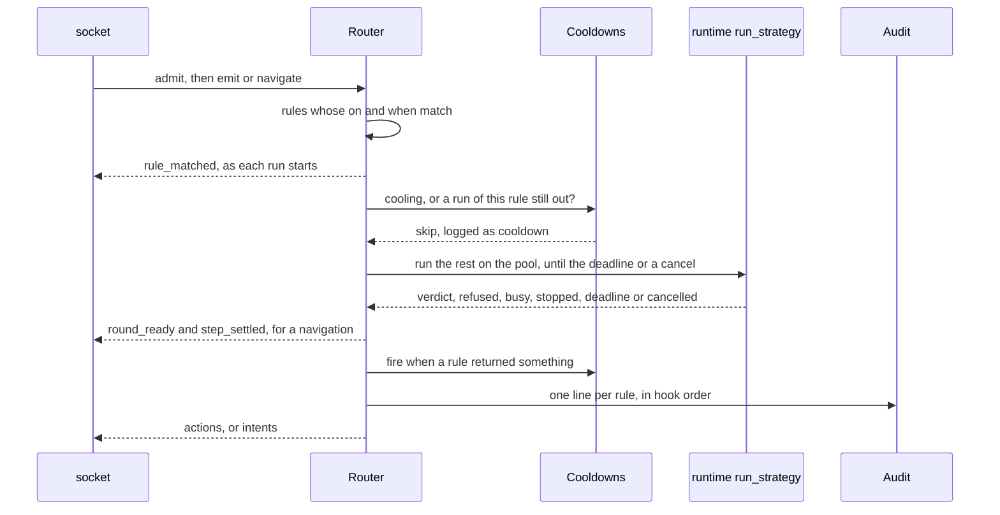

# `route`

Sends an event, or a navigation, to every rule that hooks it, runs them on the
router's pool of workers, and appends what each did to the audit log. An
inline strategy runs on its own and returns its verdict.

| File           | Holds                                                                                                                                                          |
| -------------- | -------------------------------------------------------------------------------------------------------------------------------------------------------------- |
| `mod.rs`       | `Router`: the loaded configuration, admission, `emit`, `replace` on reload, and one rule's run                                                                 |
| `navigate.rs`  | `Router::navigate`: intents from every hooked rule, or an inline strategy's verdict                                                                            |
| `cooldown.rs`  | `Cooldowns`: when each rule last returned something, a project's rules kept apart by project, bounded to 4,096 triples; `Flights`: the keys with a run out now |
| `log_entry.rs` | How a run ended, and each step's answer or failure, as JSON for the audit log                                                                                  |



```rust
use std::time::Duration;

use chauffeur_daemon::audit::{Audit, MAX_BYTES};

let router = Router::new(loaded, Audit::new(&paths.state, MAX_BYTES));

let permit = router.admit(Source::Harness)?;
let cancel = Cancel::new(Source::Harness).admitted(permit);
let actions = router.emit(&event, Duration::from_millis(1500), &cancel);

let permit = router.admit(Source::Integration)?;
let cancel = Cancel::new(Source::Integration).admitted(permit);
let intents = router.navigate(request, &cancel, &|event| send(event))?;
```

- Rules run on the router's own pool: at most 32 at once, with up to 8
  kept waiting between calls, so a project with hundreds of rules starts no
  thread of its own. A rule that finds every worker busy waits for one to
  finish; one still waiting when the call's deadline passes does not run and
  is logged as skipped, and a run already going reports just after it.
- A rule's `rule_matched` is sent as its run starts, not when it matches:
  a rule in cooldown or with a run still out, and one no worker starts
  before the deadline, is not announced.
- A rule no worker starts before the deadline earns a line of its own,
  `{"rule": ..., "event": ..., "session": ..., "skipped": "deadline"}`, in
  hook order among the runs, and returns nothing; the wire has no event for
  it.
- A run a worker started and did not finish by the deadline is logged as
  `{"rule": ..., "deadline": true}`, with each of its steps settling as
  failed `deadline` in a navigation. A run that never reported is settled
  when the call stops waiting: its rule's cooldown is read then, so a
  cooling rule's line is the cooldown, the best available answer for a run
  that never returned. A run that reports no result after it starts is
  logged as the worker stopping, and an item whose worker could not start is
  logged as refused, with that error.
- The audit log keeps hook order, one line per rule, while a navigation's
  `chauffeur.event` progress streams as each run settles.
- A run whose line cannot be written still returns its action, and the
  daemon says so on stderr.
- A rule that misses the deadline, or fails, returns nothing; the other
  rules' intents still return.
- A navigation streams at most 4,096 events; its intents always return.
- A rule's cooldown and its run are keyed by project, rule and session. A
  rule with a run still out is logged as cooling rather than started again,
  so a judge that never returns holds one worker, not one per event; the run
  gives its place back when it ends, delivered or not. Past 4,096 project,
  rule and session triples, the oldest cooldown is forgotten. Cooldowns and
  the runs out start afresh with each daemon.
- A reload swaps the configuration whole; a run in progress keeps the one
  it started with. The project cache notices the new load by its epoch, so
  the next navigation rebuilds a project's rules under the new
  `projects.json` or loaded rules.
- A navigation naming a `project` also matches its `.chauffeur/rules/`,
  read within its own bounds and cached by signature and loaded configuration
  for at most 32 projects. The project and its rules folder are
  canonicalized, the walk skips symlinks, and a project rule naming a model,
  or using System Two where `projects.json` does not list the project, is
  refused and stays out. A project that cannot be canonicalized, such as a
  folder that is not there, has no rules.
- A project rule's cooldown is keyed by its project's canonical path, so a
  project reached through a symlink or another spelling cools down once, and
  two projects with a rule of the same ID do not suppress each other.
- A project rule's audit entry carries that canonical path as `project`,
  right after `rule`, so one project's runs read the same however the request
  spells it, and two projects' runs of a rule of the same ID can be told
  apart; a loaded rule's entry keeps exactly the fields it had and no
  `project`.
