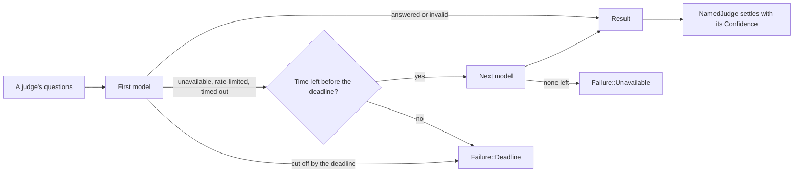

# `tiers`

The four kinds of judge a step can name, and how a tier's models answer as
one core `Judge`. Each tier's folder holds the API formats that tier uses.

| Path          | Holds                                                                                                                                                                                                               |
| ------------- | ------------------------------------------------------------------------------------------------------------------------------------------------------------------------------------------------------------------- |
| `mod.rs`      | `Tier`: `facts`, `system-one`, `system-two`, `person`                                                                                                                                                               |
| `fallback.rs` | `Fallback`: a tier's models in order, built from `models.json` and the keys found. The next model answers only what the one before could not, and every model's work ends at the round's deadline                   |
| `judge.rs`    | `NamedJudge`: a `Fallback`, a `Confidence`, the run's evidence and its deadline, as a core `Judge`                                                                                                                  |
| `system_one/` | Fast classifiers. The `systemone` format asks a yes/no question as `noul` and any other as `choice` or `score`, as the model's entry says: [system_one](system_one/README.md) has its files, its entry and its wire |
| `system_two/` | Reasoning models. The `openai` and `anthropic` formats arrive with slice 11; for now the folder holds only its README                                                                                               |
| `facts/`      | JavaScript facts, with no model. The `facts` format arrives with slice 4; for now the folder holds only its README                                                                                                  |
| `person/`     | The user, through the harness. The `person` format arrives with slice 5; for now the folder holds only its README                                                                                                   |

Until a tier has its own format, only a placeholder listed under that tier
in `models.json` answers its steps. With none, they fail as unavailable.



```rust
use std::time::{Duration, Instant};

use chauffeur_core::Panel;
use chauffeur_judges::{Fallback, NamedJudge, Tier};

let keys = |env: &str| std::env::var(env).ok();
let models = Fallback::build(&loaded, Tier::SystemOne, None, keys)?;

let deadline = Instant::now().checked_add(Duration::from_secs(5));
let judge = NamedJudge::new(&models, &confidence, &evidence)
    .with_deadline(deadline);

let run = plan.run(&Panel::new().with("quick", &judge))?;
```

- A model whose key is missing is left out, so a shipped model starts
  answering once its key is set.
- An invalid reply does not fall back: the model answered badly, and asking
  another would hide it.
- Without the `systemone` feature, as in the browser build, `systemone`
  models are left out as if their key were missing.
- A judge's deadline is one moment that all its models share. Each model is
  asked only while time is left, and one call takes at most the shorter of
  the model's `timeout_ms` and the time left, from connecting to reading the
  whole reply.
- A model that runs out its own timeout with time left fails as timed out,
  and the next model answers. Once the deadline passes, the questions still
  open fail as `Failure::Deadline` and no further model is asked; answers
  and failures already given stand.
- `Fallback::answer_all_until` and `Format::answer_all_until` take the
  deadline; `answer_all` is the same call with none. The format's default
  refuses a round whose deadline has passed and otherwise calls
  `answer_all`, which it cannot interrupt, so a format that blocks, such as
  `systemone`, overrides it to end its work at the deadline.
- With no deadline, as `NamedJudge::new` gives, nothing reads the clock, which
  the browser build does not have.
