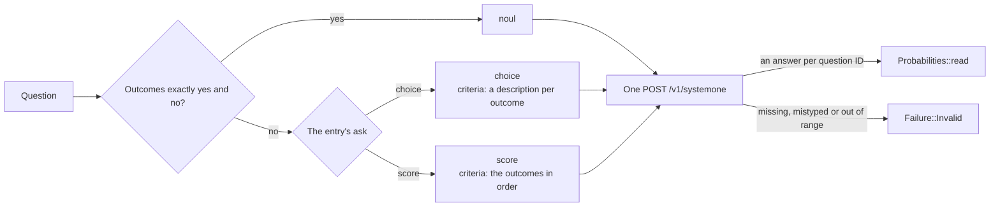

# `system_one`

The System One tier: fast classifiers. Its `systemone` format speaks the
`/v1/systemone` API that Jev, SubQ Snap and Fastino GLiDE share. It asks every
question of a round in one call and reads a probability for every outcome.

| File        | Holds                                                                                                                         |
| ----------- | ----------------------------------------------------------------------------------------------------------------------------- |
| `mod.rs`    | `SystemOneEntry`, a model's settings in `models.json`, and `SystemOneAsk`, how it is asked a question that is not yes/no      |
| `client.rs` | `SystemOne`: the HTTP client, whose call takes the shorter of the model's timeout and the time left before the deadline       |
| `wire.rs`   | The request and reply shapes: how a question is asked as `noul`, `choice` or `score`, and how each answer is read and checked |



```rust
use chauffeur_judges::{Evidence, Format, Outcomes, Question, SystemOne};

let jev = SystemOne::new(&entry, key);

let outcomes = Outcomes::new(["low", "medium", "high"])?;
let urgency = Question::new("How urgent is it?", outcomes, ["prompt"])?;
let evidence = Evidence::new([("prompt", "Fix the login bug today")]);

let replies = jev.answer_all(&[&urgency], &evidence);
// → [Ok({ low: 0.15, medium: 0.69, high: 0.16 })]
```

## The entry

```json
{
  "models": {
    "glide": {
      "format": "systemone",
      "endpoint": "https://api.fastino.ai",
      "model": "fastino/GLiDE",
      "key": { "env": "FASTINO_API_KEY" },
      "timeout_ms": 3000,
      "store": false
    }
  }
}
```

| Field        | Holds                                                                                                                       |
| ------------ | --------------------------------------------------------------------------------------------------------------------------- |
| `endpoint`   | The API's base URL. Requests go to `{endpoint}/v1/systemone`                                                                |
| `model`      | The model ID sent with each request                                                                                         |
| `key`        | The environment variable holding the key, sent as a bearer token                                                            |
| `timeout_ms` | How long one call may take. 3000 when left out                                                                              |
| `store`      | Sent as the request's top-level `store`. Left out of the request when not set: a provider may refuse a key it does not know |
| `ask`        | `"choice"` or `"score"`: how a question that is not yes/no is asked. `"choice"` when left out                               |

Any other field is refused when `models.json` loads.

## The request

A question's ID is its position in the round: `q0`, `q1` and so on. `state`
holds the evidence blocks the round's questions name, each once.

```json
{
  "model": "jev-latest",
  "state": "prompt:\nFix the login bug today\n\n",
  "questions": {
    "q0": { "type": "noul", "instructions": "Is this a coding task?" },
    "q1": {
      "type": "choice",
      "instructions": "Which skill fits?",
      "criteria": { "cli": "Use the command line", "none": "none" }
    }
  }
}
```

An entry with `"ask": "score"` sends a question that is not yes/no as a
scale:

```json
{
  "type": "score",
  "instructions": "How urgent is it?",
  "criteria": ["low", "medium", "high"]
}
```

| Type     | Asked when                                       | `criteria`                                                |
| -------- | ------------------------------------------------ | --------------------------------------------------------- |
| `noul`   | The outcomes are exactly `yes` and `no`          | None                                                      |
| `choice` | Any other question, when the entry asks `choice` | Each outcome's description, or its value when it has none |
| `score`  | Any other question, when the entry asks `score`  | The outcomes' values in order, the lowest level first     |

## The reply

```json
{
  "answers": {
    "q0": { "type": "noul", "noul": 0.97 },
    "q1": {
      "type": "choice",
      "choice": "cli",
      "confidence": 0.8,
      "probabilities": { "cli": 0.9, "none": 0.1 }
    }
  }
}
```

```json
{
  "type": "score",
  "score": 1,
  "expected_level": 1.01,
  "confidence": 0.54,
  "probabilities": { "0": 0.15, "1": 0.69, "2": 0.16 }
}
```

| Type     | Probabilities come from                                               |
| -------- | --------------------------------------------------------------------- |
| `noul`   | `noul`, the chance of `yes`; `no` has the rest                        |
| `choice` | `probabilities`, keyed by outcome value                               |
| `score`  | `probabilities`, keyed by level: `"0"` for the first outcome to n − 1 |

- Each answer is read on its own. One that is missing, cannot be read or
  fails a check below fails its question as `Failure::Invalid`, and the
  round's other questions keep their answers.
- An answer's `type` is the type its question was asked as.
- `probabilities` has exactly one entry per outcome, each from 0 to 1 and
  not all zero, which `Probabilities::read` checks.
- `confidence`, when given, is from 0 to 1.
- `choice`, when given, names an outcome. It need not be the likeliest: the
  answer settles from the probabilities alone, and two close probabilities
  can tie once they are rounded to thousandths.
- `score` and `expected_level`, when given, lie on the scale, from 0 to
  n − 1. The level is always the one the probabilities give, through
  `Probabilities::level`: Jev and SubQ send that weighted level as `score`,
  while GLiDE sends it as `expected_level` and the likeliest level's index
  as `score`.
- A reply over 262,144 bytes is invalid. Status 429 and 529 fail the round
  as rate-limited, 408 as timed out, and any other status outside 200 to
  299 as unavailable.
- A failure carries nothing from the reply, whose text can repeat the
  evidence.
