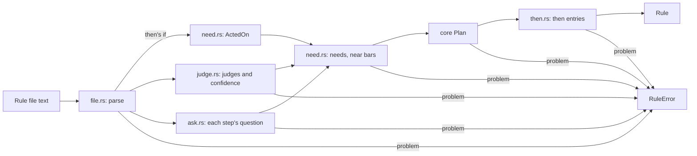

# `rule`

Loads one rule file and checks it, so a bad rule is refused when it loads,
with its ID and the reason, and never fails while running.

| File          | Holds                                                                                                                         |
| ------------- | ----------------------------------------------------------------------------------------------------------------------------- |
| `mod.rs`      | `Rule::parse`, then `hooks` (its `on` and `when` match an event) and the loaded parts                                         |
| `file.rs`     | The rule file as written, before any check, with each step's `after` and `after_any` needs                                    |
| `strategy.rs` | `Strategy`: a rule's judges and steps as a core plan, at most 16 steps; a request may send one inline                         |
| `judge.rs`    | `JudgeSpec` (tier, model, confidence) from `judges`, or a tier named directly                                                 |
| `ask.rs`      | A step's question, inline or named in `asks`                                                                                  |
| `need.rs`     | A step's needs as core needs: what `then` acts on, the bounds on each need, and the bars `near` takes from the target's judge |
| `then.rs`     | A `then` entry: its `if` names real steps and outcomes, or `decision` and an outcome some step has, with one action or intent |
| `append.rs`   | A `message.append` payload: text `parts`, a `delivery` and an optional one-line `label`                                       |
| `error.rs`    | `RuleError`, one variant per check, each naming the rule                                                                      |



```rust
use chauffeur_protocol::Rule;

let rule = Rule::parse("conventional-commits", &std::fs::read_to_string(path)?)?;

for (name, spec) in rule.judges() {
    println!("{name}: {:?}", spec.tier);
}
```

A step waits on earlier steps with `after`, needs that must all hold, and
`after_any`, needs of which one must. Here `sure` asks GLiDE when Jev's
answer is near the bar on `yes`, the outcome `then` acts on, or Jev fails:

```json
"strategy": [
  { "id": "fast", "judge": "jev", "ask": "nonconventional" },
  { "id": "sure", "judge": "glide", "ask": "nonconventional",
    "after": [{ "step": "fast", "near": 0.15, "when": ["failed"] }] }
],
"then": [{ "if": { "decision": "yes" }, "message.append": { … } }]
```

With `jev` at a confidence of 0.7, the need lowers to:

```rust
let bar = Bar { outcome: 0, at: 700 };

Need::outcome("fast", Some(Near::new(150, [bar])), Some(vec![When::Failed]))
```

- A string need is `Need::settled`; an object need is `Need::outcome`, its
  `near` a margin from 0 to 1 and its `when` the step's outcomes, `unsure`
  and `failed`.
- `near` bars the outcome named by `outcome`, which comes only with
  `near`. Without it, `near` bars each outcome of the step that a `then`
  entry expects of it, or of `decision` when the step has that outcome, or
  that any need on the step lists in `when`. A step sharing its ask bars
  nothing for it, and an inline strategy, which has no `then`, bars only
  what `outcome` or a `when` names.
- Each bar is the confidence of the judge of the step waited on, per outcome
  when it has one per outcome. `near` with no outcome to bar, or on a judge
  with no `confidence`, is refused.
- Each needs list holds at most 64 needs and each `when` 66 values, and every
  step ID and outcome a need names is at most 16 KiB, checked before anything
  reads them. Needs are kept as written, repeats included.
- `Plan::new` refuses a need on an unknown, later or the same step, an empty
  `when`, an object need with neither `near` nor `when`, and more near
  needs on a step than its codes hold.
- `decision` in a `then` entry's `if` is always the run's decision: the
  step that opened in the greatest round, the latest in plan order among
  those, where a failure counts and a skipped step never does. It expects an
  outcome some step has, `unsure` or `failed`.
- `decision` is reserved as a step ID: the loader returns `RuleError::Plan`
  with `PlanError::ReservedStep` when the strategy loads, before its needs
  are lowered.
- A step may name a tier, such as `system-one`, without declaring it in
  `judges`; it then settles on the likeliest outcome.
- A per-outcome confidence must cover exactly the step's outcomes.
- A judge's `model` is asked before its tier's models, which answer if it
  is not registered or cannot answer; see
  [`tiers`](../../../judges/src/tiers/README.md).
- A rule file is held to the limits a `chauffeur.navigate` request is, used
  or not: a strategy over its steps, judges or asks, a question over 64
  outcomes, or a text over 16 KiB is `RuleError::Limit`. A blank step ID is
  `RuleError::BlankStep`.
- A `then` entry holds exactly one action or intent beside `if`, and none
  may be named `rule`, which names the rule on the wire.
