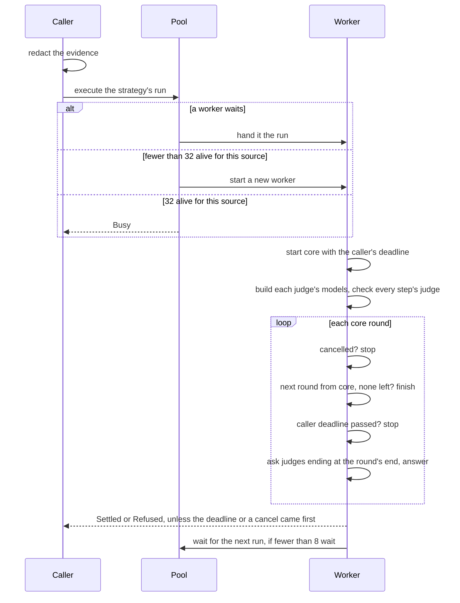

# `run`

Runs one strategy: a rule's for an event, or a navigation's inline one. The
evidence is redacted on the calling thread, then the judges are asked on a
worker thread, and the caller waits for the result until its deadline or its
cancellation.



| File        | Holds                                                              |
| ----------- | ------------------------------------------------------------------ |
| `mod.rs`    | Entry points, model assembly, judge checks, each round's panel     |
| `rounds.rs` | Core round loop, `GRACE`, each round's end, invalid-reply handling |
| `wait.rs`   | `within`: waiting for a job until done, deadline or `Cancel`       |
| `pool.rs`   | Bounded worker `Pool` and `Job`                                    |
| `log.rs`    | Bounded navigation `EventLog`                                      |

Each round's judges share one end, and an HTTP call takes the lesser of its
model's `timeout_ms` and the time left before that end.

| Round | Judges end                          | So that                         |
| ----- | ----------------------------------- | ------------------------------- |
| First | 100 ms (`GRACE`) past the deadline  | the caller's wait answers first |
| Later | 1 s (`RESERVE`) before the deadline | answers in hand return in time  |

A first round slower than the deadline is cut by the caller's wait, which
answers `Deadline`; its model call stops `GRACE` later and frees the worker. A
later round's step whose model is still working at core's end fails as
`Failed(Deadline)`, and the run returns `Settled` with the answers in hand.
Model assembly checks the caller's deadline; core reads its round clock only
when advancing needs it.

Before any judge is asked, every step's rule-local judge ID must name one of
the strategy's judges. Each round's panel is built for that round, with that
round's end. Each turn checks cancellation first, then asks core for the next
round. When core has no round left, `finish` produces the events and verdict,
so answers that came after the caller's deadline still settle their steps. The
caller's deadline is checked only before a round that would still be asked.
Core skips a later round's pending steps once less than `RESERVE` and
`MIN_ESCALATION` remain, so a run whose deadline passes during a round
settles with those steps skipped. Core groups each judge's requests into one
batch. The driver gives the answers back together; a refused batch fails the
open round as `Invalid`. Cancellation between rounds prevents later requests.

Workers are kept between runs. A run that outlives its deadline keeps its worker
busy until its round's judges end; the next run takes another worker, or starts
one, so it is never held up. At most 8 workers wait between runs, enough for
every rule one event hooks to start at once, and at most 32 per source are
alive. `Busy` means every worker was busy, and a thread that cannot start is
`Failed` with its error in `Waited`, `Refused` in `Ran`. A job retains the
navigation's permit until it really finishes; cancelling its wait cannot
refill its share. Separate source pools keep integration work off harness
workers, and a `Cancel` names its source, which picks one.

```rust
use chauffeur_runtime::{Cancel, Ran, Source, run_strategy};

let cancel = Cancel::new(Source::Harness);
let ran = run_strategy(&context, &rule, &evidence, deadline, &cancel);

match ran {
    Ran::Settled(run) => { /* the verdict; ran.then(&rule) is what it returns */ }
    Ran::Refused(reason) => { /* a judge or model failed; reason says why */ }
    Ran::Busy => { /* every worker was busy */ }
    Ran::Stopped => { /* the worker stopped without a result */ }
    Ran::Deadline | Ran::Cancelled => { /* a late result is dropped */ }
    _ => { /* a variant a newer runtime adds */ }
}
```

Both enums are `#[non_exhaustive]`, so a match outside the crate ends in
`_`.

`Pool` and `within` work for any job:

```rust
use chauffeur_runtime::{Cancel, Pool, Source, Waited, within};

let pool = Pool::new(2, 4);

let waited = within(&pool, deadline, &Cancel::new(Source::Harness), |_, _| 42);

match waited {
    Waited::Done(value) => { /* the job's value; here, 42 */ }
    Waited::Deadline => { /* the job did not finish in time */ }
    Waited::Cancelled => { /* the caller cancelled it */ }
    Waited::Busy => { /* every worker was busy */ }
    Waited::Failed(error) => { /* a thread could not start; error says why */ }
    Waited::Stopped => { /* the worker stopped without a result */ }
    _ => { /* a variant a newer runtime adds */ }
}
```
