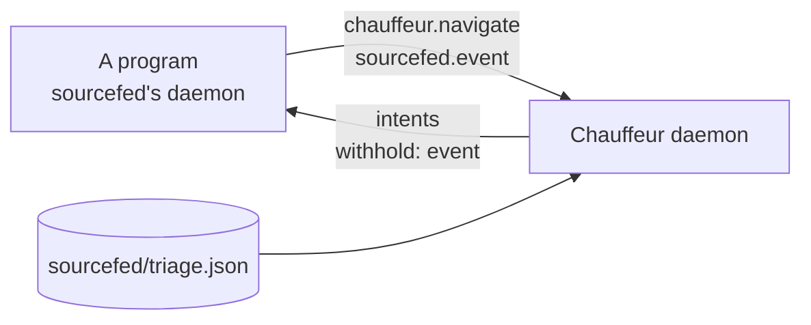

# Integrations

An integration is another program that asks Chauffeur a question. It names
its own event, sends its evidence, and acts on the intents that come back.
The policy stays in a rule file the user can read and edit, so the program
holds no thresholds or prompts.



- **The caller names the event, under its own name.** A rule hooks
  `sourcefed.event` in `on` and knows whose event it is.
- **The caller defines its intents.** A rule's `then` returns them, such as
  `withhold`; no intent means the caller's default.
- **The rule ships with the caller.** Its installer writes it to
  `~/.config/chauffeur-next/rules/<project>/`, and the daemon loads it on the
  next event.
- **The caller decides what no answer means.** It sets a deadline, and acts
  on its default when the daemon is missing, refuses or runs late.

| Project   | Asks                                                       | Page                      |
| --------- | ---------------------------------------------------------- | ------------------------- |
| sourcefed | Whether each GitHub, Jira or Slack event reaches the agent | [sourcefed](sourcefed.md) |

## Ask from your own program

A program reaches the daemon in one of three ways, each with the same
request:

| From       | Use                                                                                             |
| ---------- | ----------------------------------------------------------------------------------------------- |
| TypeScript | The [`@fdcn/chauffeur`](../../packages/chauffeur/README.md) client's `navigate`                 |
| A script   | [`chauffeur navigate`](../cli/navigate.md), with the request on stdin                           |
| Rust       | The `crates/protocol` types, over the [wire contract](../plans/slices/slice-2.md#wire-contract) |

```ts
import { navigate } from "@fdcn/chauffeur/client"

const { intents } = await navigate(
  { on: "sourcefed.event", evidence: { event, thread, monitor } },
  { signal: AbortSignal.timeout(3_000) }
)

const withheld = intents.some((intent) => intent.withhold === "event")
```
