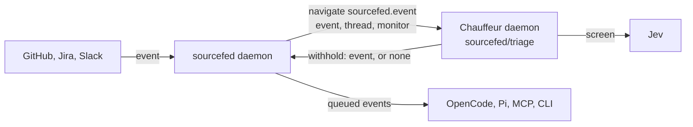

# sourcefed

[sourcefed](https://github.com/wrkhse/sourcefed) watches GitHub pull
requests, Jira issues and Slack threads, and delivers their events to agent
sessions in OpenCode, Pi, MCP and its CLI. With Chauffeur, sourcefed asks
before it queues each event, so approvals, thanks and bot comments stay out of
the session while CI failures and requested changes still arrive, on every
host at once.



## Set it up

1. Install `chauffeur-next` and start its daemon, as in the
   [README](../../README.md#install).
2. Install sourcefed, as in
   [its README](https://github.com/wrkhse/sourcefed#install).
3. Add the rule:

   ```sh
   sourcefed setup chauffeur
   ```

   It writes `~/.config/chauffeur-next/rules/sourcefed/triage.json` and never
   replaces a rule file that is already there. `sourcefed setup` writes it
   too when `~/.config/chauffeur-next/` exists.

4. Check that the daemon loaded it:

   ```sh
   chauffeur-next daemon status   # "rules" lists "sourcefed/triage"
   ```

sourcefed's daemon finds Chauffeur by itself: `$CHAUFFEUR_SOCKET` when it is
set, or else the `chauffeur` and then the `chauffeur-next` socket in the
runtime folder.

## Try it

Send the rule an event by hand, as sourcefed does:

```sh
chauffeur-next navigate <<'EOF'
{ "protocol": 1, "deadline_ms": 3000, "on": "sourcefed.event",
  "evidence": { "event": "thanks, looks good 👍", "monitor": "PR #42" } }
EOF
```

The last line is the answer. A `no` from Jev withholds the event:

```json
{
  "id": 1,
  "jsonrpc": "2.0",
  "result": { "intents": [{ "rule": "sourcefed/triage", "withhold": "event" }] }
}
```

## Tune it

The rule asks System One one question, `screen`: "Should the agent be shown
this event now?", with the `event`, `thread` and `monitor` evidence, at
confidence 0.7. Only a `no` withholds; `yes`, `unsure` and a failure
deliver. Edit the file's `confidence` or `instructions`, and the daemon
uses the edit on the next event.

```json
{
  "on": "sourcefed.event",
  "judges": { "quick": { "tier": "system-one", "confidence": 0.7 } },
  "strategy": [
    {
      "id": "screen",
      "judge": "quick",
      "ask": {
        "outcomes": ["yes", "no"],
        "evidence": ["event", "thread", "monitor"],
        "instructions": "A sourcefed event arrived for the coding agent's session. … Should the agent be shown this event now? …"
      }
    }
  ],
  "then": [{ "if": { "screen": "no" }, "withhold": "event" }]
}
```

## When Chauffeur cannot answer

With no Chauffeur, an error, or no answer within 3 seconds, sourcefed
delivers the event. A withheld event reaches no host, so sourcefed's log has
one line for each, naming the event, the monitor and the rule.

How sourcefed builds the evidence, keeps its connection and marks what
Chauffeur triaged is in
[sourcefed's Chauffeur v2 triage](https://github.com/wrkhse/sourcefed/blob/main/packages/daemon/src/triage/README.md).
Moving from v1's event gate is in
[sourcefed events](../migration/sourcefed.md).
