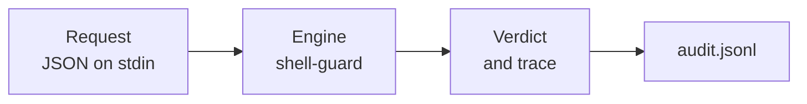

# Judgment core without Luau

Status: Implemented, released as core-v0.1.0-rc.1.

## You can

Pipe a tool call to `chauffeur-core judge` and get a verdict, the trace of
how a rule reached it, and a record in the audit log:

```sh
printf '%s\n' '{
  "id": "call-1",
  "session": "s1",
  "hook": "tool_before",
  "subject": { "tool": "shell", "input": { "command": "rm -rf /" } }
}' | chauffeur-core judge | jq .verdict
```

```json
{
  "outcome": "deny",
  "rule": "shell-guard",
  "reason": "rm uses recursive and force flags against a root target"
}
```

A hook that calls the CLI treats a non-zero exit as deny, so an invalid
request or an unwritable audit log fails closed.



## Recording

The released binary judges a real `git status` call and prints its verdict and
trace. A fresh process then runs `audit 1` and shows the same decision.


## What it builds

### Request and verdict types

A request is parsed once at the boundary and every part is bounded. A verdict
is an outcome, the rule that chose it and a reason. Outcomes order as
`Allow < Ask < Deny`, so the strictest of several opinions is their maximum.

```rust
let request = Request::parse(
    r#"{ "session": "s1", "hook": "tool_after",
         "subject": { "tool": "shell", "input": { "command": "ls" } } }"#,
)?;

let command = request.field("input.command");
let verdict = Verdict::new(Outcome::Ask, "shell-guard", "path is in ~/.ssh")?;
```

A request without an `id` gets one derived from its content. Verified by unit
tests at each bound and one byte past it.

### Rule interface and shell-guard

A `Rule` has a static name and judges a request, recording one opinion event
in the trace, or abstains. A `RuleSet` holds at most 16 distinct rules in
order. `shell-guard` is the built-in demonstration rule: it allows a literal
`git status`, asks about credential paths under `~/.ssh`, and denies
`rm -rf /`. It abstains on everything else.

```rust
let mut rules = RuleSet::new();

rules.insert(Box::new(ShellGuard))?;

assert_eq!(rules.names(), vec!["shell-guard"]);
```

Verified by unit tests of each shell-guard outcome and abstention, and of the
name, duplicate and size checks on the set.

### Engine and trace

The engine asks each rule in order and keeps the strictest outcome; the first
rule wins a tie. When no rule has an opinion the verdict is absent and the
host decides what that means. The trace records `rule_started`,
`rule_opinion`, `decided` and `finished` events, at most 256, with a final
slot reserved so a noisy rule cannot hide the end.

```rust
let request = Request::parse(
    r#"{ "session": "s1", "hook": "tool_after",
         "subject": { "tool": "shell",
                      "input": { "command": "git status" } } }"#,
)?;

let engine = Engine::new(RuleSet::builtin());
let judgment = engine.judge(&request);

assert_eq!(judgment.verdict().map(Verdict::outcome), Some(Outcome::Allow));
assert_eq!(judgment.trace().events().len(), 4);
```

Verified by unit tests that every order of three rules gives the same
outcome, and that a noisy rule leaves `finished` last with the drops counted.

### Audit log

Each judgment is appended to `audit.jsonl` as one JSON line. At 8 MiB the
file rotates over `audit.1.jsonl`, and a read returns at most the newest 1024
records. Each record's `at` is 20 zero-padded digits of Unix seconds, a dot, and
six zero-padded digits of microseconds; the width is fixed so records sort as
text in time order. The log refuses a symlinked path and a folder another user
owns, and locks around every append and read.

```rust
let log = AuditLog::new(Path::new("state"));
let record = AuditRecord::new(&request, &judgment)?;

log.append(&record)?;

let latest = log.recent(1)?;
```

Verified by unit tests of rotation, torn lines, permissions and concurrent
appends.

### CLI

`chauffeur-core` judges a request from stdin, lists the built-in rules, reads
the audit log and prints its version. `CHAUFFEUR_CORE_STATE_DIR` chooses the
state folder; otherwise it is `~/.local/state/chauffeur-core`.

```sh
chauffeur-core rules      # shell-guard
chauffeur-core audit 3    # the newest three records, one JSON line each
chauffeur-core version    # 0.1.0-rc.1
```

Verified by process tests that run the binary for each command and for
oversized stdin.

### CI gates

`core.yml` runs these from `core/` on every pull request, and mutation
testing over the diff:

```sh
cargo fmt --all -- --check
cargo clippy --workspace --all-targets --all-features --locked -- -D warnings
cargo nextest run --workspace --all-features --locked
cargo nextest run -p chauffeur-cli --test cli --run-ignored only --locked
cargo test --workspace --doc --all-features --locked
cargo deny check
```

Verified by the workflow itself: every step passes on the final tree.

## End to end

The release smoke builds the release binary, points
`CHAUFFEUR_CORE_STATE_DIR` at a fresh folder and judges three requests:
`git status` is allowed, a read of `~/.ssh/id_ed25519` asks, and `rm -rf /` is
denied. A separate `chauffeur-core audit 3` process then reads the three
records back in order with the same request ids and outcomes.
