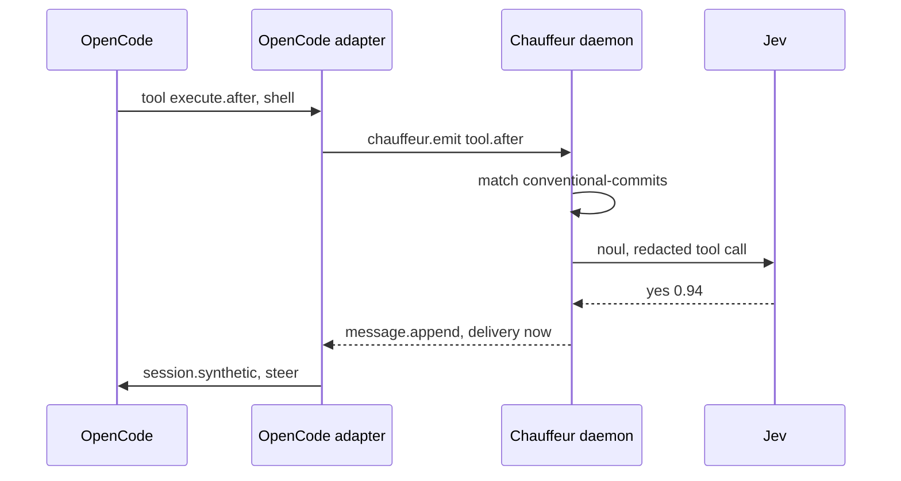
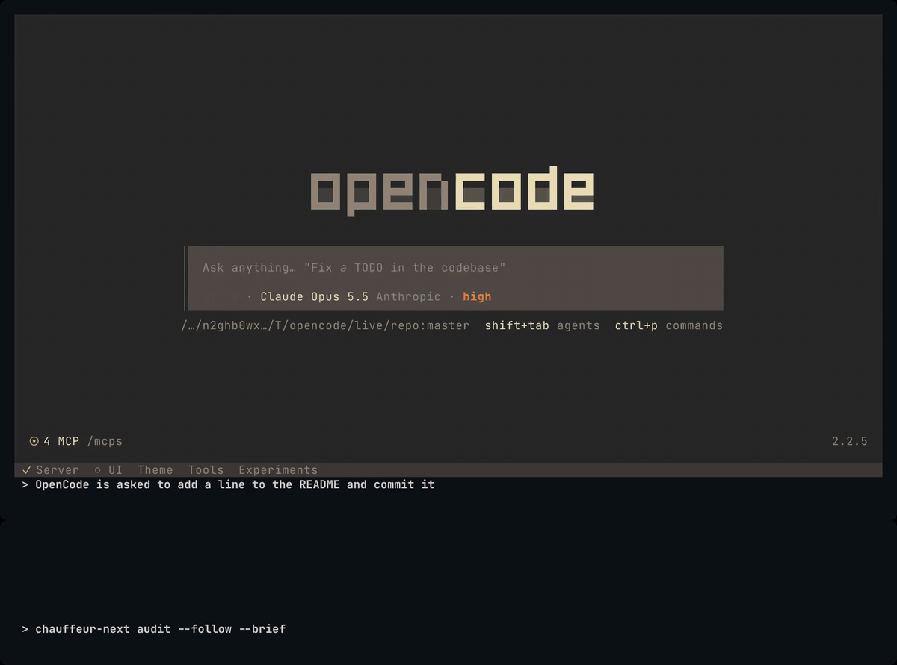

# Slice 1: Conventional Commits nudge in OpenCode

**Status:** Implemented. `chauffeur-next` `1.0.0-rc.4` is its release, and
later candidates carry it. The recording below shows `1.0.0-rc.3`.

**You can:** install the rc beside v1 and add its OpenCode adapter to
`plugins` in `opencode.jsonc`. When the agent commits with a message such as
`fixed stuff`, Chauffeur's message follows in the conversation, and the agent
amends the commit unless you chose the message. OpenCode shows it as one row:

```text
◈ Chauffeur · conventional-commits: commit message isn't conventional; asking the agent to amend it
```

An `unsure` or `failed` answer sends nothing.



## Recording

OpenCode with `chauffeur-next` `1.0.0-rc.3` and Jev, above
`chauffeur-next audit --follow --brief`. Asked to add a line and commit it, the
agent commits as `Add …`. Jev answers yes at 0.89 in 367 ms, Chauffeur's
message arrives in the conversation, and the agent amends the commit to
`docs(readme): add hello line`.



## What it builds

Each part says what it does on the nudge's path. Its types are described once,
in the code docs its **Structure** line links.

### Core: one round of steps

A plan of named steps, each asking one judge one question; the judges by name
in a `Panel`; the events a run emits and the `Verdict`, each step's
`Outcome`. In this slice's releases every step is asked in one round.

Files: `crates/core/src/plan/`, `judge.rs`, `event.rs`

```rust
let step = Step::new("commit", "system-one", "Is this message conventional?");
let plan = Plan::new([step])?;

let yes = |_: &&str| Outcome::Value("yes");
let run = plan.run(&Panel::new().with("system-one", &yes))?;

assert_eq!(run.verdict.get("commit"), Some(&Outcome::Value("yes")));
```

Structure: [`crates/core/src/plan/`](../../../crates/core/src/plan/README.md).
That page also covers the `after` needs and rounds from slice 3, which arrive
in the next release candidate.

Verified by:

- Scenario tests, Miri and `cargo-mutants` over the one-round run.

### Rule files

Loading and checking a rule file: `on`, `when`, `judges`, `asks`,
`strategy`, `then` and `cooldown_seconds`. `when` is checked before any
judge is asked: the event's tool is one of `tools`, if any are listed, and
some string in its `input` contains the text. A `then` entry returns its
action, such as `message.append`, for an outcome, `unsure` or `failed`. A
tool event's evidence is `tool_call`, the tool and its input, and
`tool_output`; any other event gives each string field under its own name.

Files: `crates/protocol/src/rule/`, `when.rs`, `then.rs`, `event.rs`

```rust
// A RuleError names the rule and the reason.
let rule = Rule::parse("conventional-commits", &text)?;

let event = Event::parse(
    r#"{ "event": "tool.after", "tool": "shell",
         "input": { "command": "git commit -m wip" } }"#,
)?;

// on and when match, before any judge is asked.
assert!(rule.hooks(&event));
```

Structure: [`crates/protocol/src/rule/`](../../../crates/protocol/src/rule/README.md)

Verified by:

- A rule naming an unknown judge is refused when it loads, with its path.

### Questions, confidence and models

A question is its instructions, its outcomes and the evidence blocks it names.
A judge's probabilities settle under the rule's confidence to one outcome or
`unsure`; `models.json` comes from shipped and user configuration; a
`placeholder` stands in for a model.

Files: `crates/judges/src/question/`, `confidence/`, `config/`, `format.rs`,
`placeholder/`

```rust
let instructions = "Does this commit message break Conventional Commits?";
let question = Question::noul(instructions, ["commit"])?;

let p = Probabilities::read(question.outcomes(), [("yes", 0.94), ("no", 0.06)])?;
let bar = Confidence::Bar(Milli::new(700).ok_or("bar")?);
let by = AnsweredBy { model: "jev".into(), placeholder: false };

let answer = Answer::settle(&question, p, &bar, by);
assert_eq!(answer.outcome(), &Settled::Outcome("yes".into()));

let models = Models::load(&[shipped, user])?; // the user's entries win
```

Structure: [`question/`](../../../crates/judges/src/question/README.md),
[`confidence/`](../../../crates/judges/src/confidence/README.md),
[`config/`](../../../crates/judges/src/config/README.md) and
[`placeholder/`](../../../crates/judges/src/placeholder/README.md)

Verified by:

- Kani proves `pick` for every two or three outcomes, every probability in
  thousandths and every bar, including none: an outcome settles exactly when
  it is the only likeliest one and meets its bar, edges included, so an
  answer is one outcome or `unsure`.

  ```text
  for all p   = 2 or 3 probabilities, each 0 to 1000 thousandths
  for all bar = for each outcome, a bar from 0 to 1000, or none

  picked = pick(p, bar)

  for each outcome i:
      only_likeliest = every other p[j] < p[i]
      meets          = bar[i] is some b and p[i] >= b

      assert (picked == i) == (only_likeliest and meets)
  ```

- An outcome outside the question's list fails as `invalid`.
- Placeholders: recorded answers match by evidence, first match wins;
  `otherwise` answers the rest, and without it the step fails as
  `unavailable`; every placeholder answer is marked in events.

### Tiers and the Jev format

Each tier's models in fallback order, as one core `Judge` that reports the
model that answered. `system_one/` holds the `systemone` format, which asks
Jev a round's yes-or-no questions as `noul` in one request. It sits behind
the default `systemone` feature, so the playground builds without HTTP.

Files: `crates/judges/src/tiers/`

```rust
let keys = |env: &str| std::env::var(env).ok();
let jev_first = Fallback::build(&models, Tier::SystemOne, None, keys)?;

let judge = NamedJudge::new(&jev_first, &confidence, &evidence);
let run = plan.run(&Panel::new().with("quick", &judge))?;
// each answer names its model: AnsweredBy { model: "jev", placeholder: false }
```

Structure: [`crates/judges/src/tiers/`](../../../crates/judges/src/tiers/README.md)

Verified by:

- `main`'s `judges/jev/tests/wire.rs` replayed over loopback HTTP.
- Fallback moves on only for unavailable, rate-limited or timed out.
- A key never appears in an event, error or verdict.

### Running a rule

Runs a rule on a worker thread within its deadline, and redacts evidence
before every model call, with v1's rules and
`distribution/safety/redaction.json`.

Files: `crates/runtime/src/run/`, `redact/`

```rust
// "export TOKEN=[REDACTED]"
let sent = redactor.redact("export TOKEN=ghp_…", &mut Masking::default());

let ran = run(&context, &rule, &event, Duration::from_secs(2));
let then = ran.then(&rule); // the first then entry the verdict meets
```

Structure: [`run/`](../../../crates/runtime/src/run/README.md) and
[`redact/`](../../../crates/runtime/src/redact/README.md)

Verified by:

- v1's redaction cases.
- A judge sees only redacted evidence; a missed deadline settles nothing.

### The daemon

A private socket, its folder `0700`, carrying JSON-RPC 2.0 lines of up to
1 MiB on at most 64 connections. It loads shipped and user models, redaction
and rules, and reloads them when they change. It routes an event to the rules
that hook it, concurrently, with each rule's cooldown per session, and
appends every run to `audit.jsonl` in `~/.local/state/<name>/`, moved aside
once past 8 MiB. Its methods are `chauffeur.emit` and `chauffeur.status`.

Files: `crates/daemon/src/paths.rs`, `state.rs`, `rpc.rs`, `socket.rs`,
`audit.rs`, `route/`

```sh
chauffeur daemon run &

echo '{ "event": "tool.after", "session": "s1", "tool": "shell",
        "input": { "command": "git commit -m wip" } }' | chauffeur emit
```

Structure: [`route/`](../../../crates/daemon/src/route/README.md), with the
running daemon in [`chauffeur daemon`](../../cli/daemon.md) and the log in
[`chauffeur audit`](../../cli/audit.md)

Verified by:

- Another user's socket folder is refused.
- An oversized line and a closed connection fail safely.
- An edited rule applies to the next event.
- Reading the configuration does not reload it; creating, editing, renaming
  or removing a rule does, and settling ends at its bound.
- The audit log moves aside at its bound and reads across both files.

### The CLI

`chauffeur daemon run`, `daemon status`, `version`, `emit` and `audit`.
`audit` reads the log's files, so it works with no daemon. The installation's
name is the executable's, so `chauffeur-next` keeps its own socket,
configuration and log.

Files: `crates/cli/src/main.rs`, `audit.rs`

```sh
chauffeur audit --brief
# 13:54:43  conventional-commits  s1  nonconventional yes 0.93 jev  312 ms  → …

chauffeur daemon status   # version, loaded rules, refused rule files
```

Structure: [CLI](../../cli/README.md)

Verified by:

- The binary against a real daemon: the nudge through `emit`, `daemon status`,
  a second daemon, no daemon, refusals, and `audit` after the daemon stops.

### The OpenCode adapter

An OpenCode plugin that sends each completed tool call to the daemon as
`tool.after` and carries out what the rules return. It decides nothing: the
rules decide, and the adapter translates. It is written against OpenCode's
plugin API, `@opencode/plugin` 2, and imports only its types, so it ships as
one file with no dependencies.

Files: `adapters/opencode/src/`, `adapters/opencode/test/`

The rc ships it in `share/chauffeur-next/opencode/`, and OpenCode loads it
from there:

```jsonc
{
  "$schema": "https://opencode.ai/config.json",
  "plugins": ["/opt/homebrew/share/chauffeur-next/opencode"]
}
```

After the agent's `git commit -m 'fixed stuff'`, the adapter sends:

```json
{
  "event": "tool.after",
  "session": "ses_…",
  "tool": "shell",
  "input": { "command": "git commit -m 'fixed stuff'" },
  "output": "[v2 3f2c1a0] fixed stuff\n 1 file changed, 2 insertions(+)"
}
```

The daemon returns `message.append` with `delivery: "now"`, and the adapter
sends it to the session as its own message, steered into the running turn:

```ts
await ctx.session.synthetic({
  sessionID: "ses_…",
  text: "Chauffeur, which the user set up to check commits: …",
  description:
    "Chauffeur · conventional-commits: commit message isn't conventional; asking the agent to amend it",
  metadata: { chauffeur: { rule: "conventional-commits" } },
  delivery: "steer"
})
```

OpenCode shows the description as the message's row, and the agent reads the
text after the commit's result, from the conversation rather than from the
command's output.

- **Which installation.** The folder it ships in names the installation, so
  `share/chauffeur-next/opencode/` is the plugin `chauffeur-next`, which loads
  beside v1's `chauffeur`, and reaches `chauffeur-next`'s socket, found as the
  daemon finds it. The plugin's `socket` option or `$CHAUFFEUR_SOCKET` names
  another.
- **Every completed call** is sent, with its output's text up to 64 KiB. A
  call that fails is not sent.
- **Code Mode.** A call made inside Code Mode's `execute` is sent as itself,
  such as `shell`, and so is `execute`. A message steered from an inner
  call reaches the agent at the turn's next step, after `execute`'s result.
- **Fails open.** The adapter waits for the rules' deadline, 3 seconds by
  default (option `deadline_ms`, at most the daemon's 30), and half a second
  more. With no daemon, an error, no answer, a daemon that closes the
  connection without answering or a message OpenCode refuses, the call goes
  on and nothing reaches the agent, and the adapter writes why to
  `opencode.log` in `~/.local/state/<name>/`, beside the audit log, once a
  minute at most.
- **Actions.** `message.append` becomes one message: its text parts after one
  another, described as `Chauffeur · <rule>: <label>`, or `Chauffeur · <rule>`
  with no label. `now` steers it into the running turn, `next` queues it for
  the next turn, and `wake` queues it and starts a turn when the agent is
  idle. The tool's result stays as it was. The adapter skips any other
  action.
- **One connection per call** over the socket, so every OpenCode server on
  the machine shares one daemon, and a restarted daemon needs nothing.

Structure: [`adapters/opencode/`](../../../adapters/opencode/README.md)

Verified by:

- `bun test` against a stand-in daemon on a real socket and a stand-in
  OpenCode: the event a shell call sends; the message, description and
  delivery for `now`, `next` and `wake`, with and without a label; one
  message for a nudged call inside `execute`, with every result unchanged;
  nothing sent for no actions, no daemon, a late answer, an error reply, an
  unknown action or delivery; a message OpenCode refuses, logged; a failed
  call not sent; no options; the plugin and socket named by the folder,
  `$CHAUFFEUR_SOCKET` and the option; the log's place, its lines, and a log
  that cannot be written.
- The smoke test loads each installed `share/<name>/opencode/server.js` as
  OpenCode does and runs its hook on a commit against the real daemon: one
  steered message from `conventional-commits`, the result unchanged, and
  `audit` shows the run.

### Shipped content

Jev as the default System One, the nudge, and the known credential prefixes.

Files: `distribution/models/jev.json`,
[`distribution/rules/conventional-commits.json`](../../../distribution/rules/conventional-commits.json),
`distribution/safety/redaction.json`

```json
{
  "models": {
    "jev": {
      "format": "systemone",
      "endpoint": "https://api.typesafe.ai",
      "model": "jev-latest",
      "key": { "env": "TYPESAFE_API_KEY" },
      "timeout_ms": 3000
    }
  },
  "tiers": { "system-one": ["jev"] }
}
```

Verified by the end-to-end checks below.

### Release

Each rc tag packs the binary, `distribution/` and the OpenCode adapter for
four targets, smoke-tests each, publishes a prerelease, and renders the
`chauffeur-next` formula with its Homebrew service, whose caveats print the
`plugins` line. The steps are in
[Cutting a release candidate](../../../scripts/README.md#cutting-a-release-candidate).

Files: `scripts/package.mjs`, `homebrew.mjs`, `smoke.mjs`,
`.github/workflows/check.yml`, `release.yml`

```sh
# Installs it as chauffeur and as chauffeur-next, then runs each.
node scripts/smoke.mjs dist/chauffeur-*.tar.gz
```

Verified by:

- A packaging dry run and the smoke test on Linux and macOS.
- The rc's Homebrew `install`, `test`, `audit` and `style` on a machine
  running v1, which keeps working.

### The playground

The Question tab: a question's probabilities settled under a confidence, as
the daemon does, through the same `Answer::settle` compiled to WebAssembly.

Files: `playground/src/features/question.ts`

```ts
const result = JSON.parse(
  settle(
    JSON.stringify({
      outcomes: ["yes", "no"],
      p: { yes: 0.58, no: 0.42 },
      confidence: 0.7
    })
  )
)
// { answer: { outcome: "unsure", level: 0.42,
//              p: [{ outcome: "yes", p: 0.58 }, { outcome: "no", p: 0.42 }] } }
```

Structure: [`playground/`](../../../playground/README.md)

Verified by:

- The tab settles the plan's confidence examples in a real browser.

## End to end

- Through `chauffeur emit` and the daemon, live: the nudge goes out for a
  nonconventional commit and not for a conventional one, with Jev's answer,
  model and time in `chauffeur audit`, which still shows them after the
  daemon restarts.
- OpenCode, for real, in Code Mode: `fixed stuff` gets the nudge,
  `feat(parser): handle empty input` gets nothing; a message the agent chose
  is amended after the nudge, in each of four runs, and one the user dictated
  is kept; with Jev unreachable nothing is sent and the audit log shows
  `failed: unavailable`; calls that are not commits make no Jev call;
  OpenCode's service and a standalone server share one daemon.
