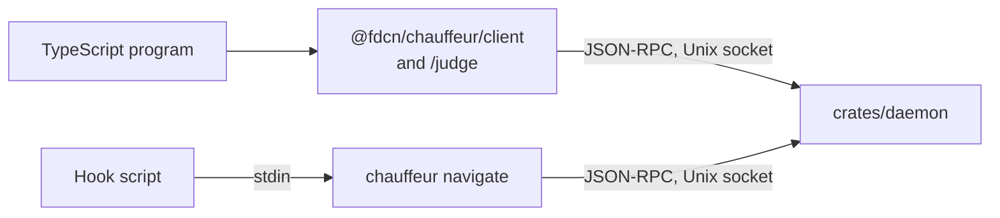

# Slice 2: sourcefed triage

**Status:** In progress: requests, intents and limits, admission and running,
and the daemon's socket are built; the rule sources, the bindings and
sourcefed's side are next.

**You can:** let sourcefed ask Chauffeur before it queues each event, so
OpenCode, Pi, MCP and the CLI receive the same filtered stream, as in
[sourcefed: one triage for every host](../pluggability.md#sourcefed-one-triage-for-every-host).
sourcefed's daemon navigates `sourcefed.event` once a v2 daemon answers its
handshake, and marks the events v2 triaged; its installer adds
`sourcefed/triage` with the System One screen, and its OpenCode adapter keeps
calling v1's `chauffeur.gate` for the events that are not marked until
cutover.

A caller sends an event or an inline strategy, with its evidence and a
deadline, and receives the events and the intents or verdict. It sends data,
never callbacks or code. This slice adds caller events, intents, the
integration and project rule sources, admission and cancellation, and the
bindings: the TypeScript client and `/judge`, and `chauffeur navigate`.



## Wire contract

A `chauffeur.navigate` request, `chauffeur.event` notifications, then the
result, as [JSON-RPC 2.0](../pluggability.md#json-rpc-2-0) lines. `chauffeur navigate` reads the request's
`params` on stdin and prints the messages it receives:

```sh
chauffeur navigate <<'EOF'
{ "protocol": 1, "deadline_ms": 3000, "on": "sourcefed.event",
  "evidence": { "event": "…", "thread": "…" } }
EOF
```

It prints one JSON-RPC message per line: `event` notifications as the run
goes, then the result. Their contents, in order:

```text
event   rule_matched  { "rule": "sourcefed/triage" }
event   round_ready   { "rule": "sourcefed/triage", "round": 1, "steps": ["screen"] }
event   step_settled  { "rule": "sourcefed/triage", "step": "screen",
                        "answer": { "outcome": "no", … } }
result  intents       [{ "rule": "sourcefed/triage", "withhold": "event" }]
```

A rejection is a JSON-RPC error whose `data.reason` names it: `invalid`,
`limit_exceeded`, `judge_unavailable`, `busy`, `deadline`,
`unsupported_protocol` or `cancelled`.

A request with `strategy` in place of `on` ends with `{"verdict": {…}}`.
`$CHAUFFEUR_SOCKET` defaults to `chauffeur/daemon.sock` in the user's runtime
directory: `$XDG_RUNTIME_DIR`, or `$TMPDIR` on macOS.

- **Answers and failures** are distinct: a step settles to
  `{"answer": {"outcome", "p", "level", "model", "placeholder"}}` or
  `{"failed": "<reason>"}`. Probabilities and the level have at most three
  decimals, and `placeholder` marks a stand-in's answer.
- **Intents** carry the rule that produced them. A rule's intents are dropped
  if its strategy misses the deadline; other rules' intents still return.
- **Evidence** is named once per navigation and referenced by steps, so a
  batched provider call carries each block once.
- **Versioning:** `protocol` is a required whole number; the daemon answers
  one it does not accept with `unsupported_protocol` and the versions it
  accepts, and each binding reports it as `unavailable`. Any other value is
  `invalid`.
- **Project:** a request may name the `project` it works in, as the absolute
  path of at most 4096 bytes, the `project_bytes` limit; a relative path, or
  one that is not text, is `invalid`. The daemon then reads that project's
  `.chauffeur/rules/` too, bounded and cached, and applies the project's
  System Two allowance. The project is canonicalized once, and that one path
  serves the walk, the allowance, the cooldown key and the audit line, so a
  symlinked worktree, or `/var` and `/private/var` spellings, is one project.
  A request whose project cannot be resolved is refused, with a message that
  quotes the path and says why; it is not treated as having no rules.
- **Inline trust:** an inline strategy carries its caller's user-level trust,
  so a judge that names a `model`, and a `person` judge, are allowed. Inline
  System Two, a judge whose tier is `system-two` or a step naming
  `system-two`, runs only when the request names a `project` that the
  user-level `projects.json` in Chauffeur's config folder lists. That file is
  a JSON list of absolute project paths, empty by default. Each entry is
  canonicalized when that file loads, not on each navigation, so a symlinked
  worktree that moves needs a reload for its allowance to follow. Without a
  `project` the request is refused at parse with `judge_unavailable`; a
  project the list does not name is refused by the daemon with
  `judge_unavailable` too. System Two stays unconfigured until slice 11.
- **Nulls:** a JSON null anywhere in `params` is `invalid`; a field with no
  value is left out.
- **Limits**, checked before admission: a request line of 1 MiB; a `project`
  of at most 4096 bytes; 32 steps per strategy, counting each copy `for_each`
  makes; 16 `after` entries per step; 32 judges and 32 asks per strategy; 64
  outcomes per question, and 64 bars in a per-outcome confidence; 64 evidence
  blocks, 64 candidates, and 64 blocks named by one ask; 256 KiB of evidence
  and candidates together, names included; 16 KiB in each text a strategy
  names: instructions, descriptions, outcome values, step IDs, judge and ask
  names, evidence names, a judge's `model`, and an outcome key in a
  per-outcome confidence; a 30 s deadline. Each rejection names its limit.
  The `after` and `for_each` limits are checked with those fields, in slices
  3 and 4.

## What it builds

### Requests, intents and limits

The `navigate` request and its intents, the limits above, and the one
`navigate` schema with the valid and invalid requests every binding's tests
replay.

Files: `crates/protocol/src/request.rs`, `intent.rs`, `limits.rs`,
`progress.rs`, `rule/strategy.rs`, `schema/navigate.json`,
`fixtures/navigate.json`

```json
{
  "jsonrpc": "2.0",
  "id": 1,
  "error": {
    "code": -32602,
    "message": "evidence is over 256 KiB",
    "data": { "reason": "limit_exceeded", "limit": "evidence_bytes", "max": 262144 }
  }
}
```

Structure:

`Navigate::parse` checks a request's `params` in order: the protocol first, so
a newer caller's fields read as `unsupported_protocol`, then the fields, the
limits, and an inline strategy. A `protocol` that is not a whole number,
such as `"1"`, `1.5` or `-1`, is `invalid`. A request without `deadline_ms` gets
`DEFAULT_DEADLINE`, 3 seconds. An empty `on` is refused, and so is an inline
step naming evidence the request does not send. `event` is what rules match:
named by `on`, with each evidence block as a field, so a block named `event`
stays a field.

```rust
pub const PROTOCOLS: [u64; 1];
pub const DEFAULT_DEADLINE: Duration;

pub struct Navigate { … }

impl Navigate {
    pub fn parse(params: &Value) -> Result<Self, Rejection>;
    pub const fn deadline(&self) -> Duration;
    pub fn project(&self) -> Option<&Path>;
    pub fn evidence(&self) -> &[(String, String)];
    pub fn candidates(&self) -> &[(String, String)];
    pub const fn target(&self) -> &Target;
    pub fn into_target(self) -> Target;
    pub fn event(&self) -> Option<Event>;
}

impl Event {
    pub const fn new(name: String, fields: Map<String, Value>) -> Self;
}

pub enum Target {
    On(String),
    Strategy(Strategy),
}
```

A rejection is the JSON-RPC error a binding receives. `to_error` adds
`limit` and `max` for a limit, and `accepted` for a protocol. The code is
`-32602` for what the caller sent, `-32000` for what the daemon could not
serve, and `-32800` for a call its caller cancelled.

```rust
pub enum Rejection {
    Invalid(String),
    LimitExceeded(Exceeded),
    UnsupportedProtocol,
    Busy,
    Deadline,
    /// An inline strategy names a judge with no model to ask, or asks for
    /// System Two without a project the user's `projects.json` allows.
    JudgeUnavailable(String),
    Cancelled,
}

impl Rejection {
    pub const fn reason(&self) -> &'static str;
    pub fn to_error(&self) -> Value;
}

impl Display for Rejection {}
impl Error for Rejection {}
impl From<Exceeded> for Rejection {}
impl From<RuleError> for Rejection {}
```

Rule files are held to the same limits as requests: a strategy of 33 steps or
33 judges, or an ask of 65 outcomes or a text over 16 KiB, used or not, is
refused when it loads, as `RuleError::Limit`; a blank step ID is
`RuleError::BlankStep`. A described outcome refuses fields beside `value`
and `description`. A rule file over 1 MiB is refused with its path.

```rust
pub enum Limit {
    Steps,
    Outcomes,
    EvidenceBlocks,
    Candidates,
    EvidenceBytes,
    Deadline,
    Judges,
    Asks,
    TextBytes,
    ProjectBytes,
}

impl Limit {
    pub const ALL: [Self; 10];
    pub const fn name(self) -> &'static str;
    pub const fn max(self) -> u64;
    pub const fn check(self, count: u64) -> Result<(), Exceeded>;
}

pub struct Exceeded {
    pub limit: Limit,
    pub count: u64,
}

impl Display for Exceeded {}
impl Error for Exceeded {}
```

A rule and an inline strategy share `Strategy`: the judges its steps name
and its steps as a core plan.

```rust
pub struct Strategy { … }

impl Strategy {
    pub const fn judges(&self) -> &BTreeMap<String, JudgeSpec>;
    pub fn uses_tier(&self, tier: Tier) -> bool;
    pub const fn plan(&self) -> &Plan<Question>;
}

impl Rule {
    pub const fn strategy(&self) -> &Strategy;
}
```

An intent is one object on the wire, `rule` and the intent itself.
`from_json` refuses an object with no `rule` or more than one intent, and a
rule file may not name a `then` entry `rule`.

```rust
pub struct Intent { … }

impl Intent {
    pub fn new(rule: &str, then: &Then) -> Self;
    pub fn from_json(value: &Value) -> Option<Self>;
    pub fn to_json(&self) -> Value;
    pub fn rule(&self) -> &str;
    pub fn name(&self) -> &str;
    pub const fn payload(&self) -> &Value;
}
```

`progress` turns a run into what the caller sees: the `chauffeur.event`
params, which the progress helpers build, and the verdict by step. A helper
leaves the id out; the socket adds the id of the call that produced each
event to its params, so every `chauffeur.event` carries the caller's id.

```rust
pub mod progress {
    pub fn rule_matched(rule: &str) -> Value;
    pub fn run_events(rule: Option<&str>, events: &[RunEvent<Answer>]) -> Vec<Value>;
    pub fn settled(outcome: &Outcome<Answer>) -> Value;
    pub fn settled_failed(rule: &str, step: &str, failed: &str) -> Value;
    pub fn verdict(verdict: &Verdict<Answer>) -> Value;
}
```

The fixtures are one file of cases, each with `params` and either
`"expect": "on"` or `"strategy"`, or a `reject` with its `reason` and
`limit`. A case with `fill` has `text` repeated `times` put at the JSON
pointer `at` in its params before it is sent, so the file stays small. A
rejected case the schema cannot see as rejected, such as one over a byte
limit, carries `"schema": "accepts"`. A rejected case `Navigate::parse`
accepts, because the daemon refuses it later, carries `"parsed": "accepts"`.

```json
{
  "name": "evidence over 256 KiB",
  "params": { "protocol": 1, "on": "sourcefed.event", "evidence": { "log": "" } },
  "fill": [{ "at": "/evidence/log", "text": "€", "times": 87381 }],
  "reject": { "reason": "limit_exceeded", "limit": "evidence_bytes" },
  "schema": "accepts"
}
```

Verified by:

- Round-trip and rejection cases for every limit and malformed field,
  including a JSON null in `params`, duplicate outcomes, reserved outcome
  names and a per-outcome confidence that misses an outcome:
  `crates/protocol/tests/navigate.rs` replays the fixture cases and checks
  that every limit has one, at and over it, that bytes count as UTF-8 across
  evidence, candidates and every named text, and that a relative `project` is
  refused. Each accepted case keeps its deadline, evidence, candidates, step
  IDs and judges.
- The same test file checks every case against `schema/navigate.json`
  with the `jsonschema` crate: accepted cases, and rejected ones tagged
  `"schema": "accepts"`, fit it; every other rejected case does not.
- Every shipped rule file loads within the limits, and one over 1 MiB is
  refused with its path.

### Admission and running

One permit per navigation, shared by the caller and every job, held until
both the caller releases it and its last worker is free, with
per-source and global capacity; a bounded worker pool; the deadline and
cancellation checked before each round; late results discarded.

Files: `crates/runtime/src/admission.rs`, `run/mod.rs`, `run/wait.rs`,
`run/pool.rs`, `run/log.rs`, `proofs.rs`

```rust
// Err(Busy) while the source's share or the capacity is in use.
let permit = admission.admit(Source::Integration)?;

// Cancellation and the deadline are checked before the round starts.
let ran = run_strategy(&context, &strategy, &evidence, deadline, &cancel);

deliver(ran); // a result after the deadline or a cancel is dropped
drop(permit); // its jobs keep a copy until their workers are free
```

Structure:

The daemon admits each navigation for its source: `Harness` for
`chauffeur.emit`, `Integration` for `chauffeur.navigate`. `Capacity::DAEMON`
allows 16 at once, 8 from each source, so a flood from one source leaves the
other its share. A cancelled or late job keeps its permit until its worker
finishes; cancellation cannot refill a share with work still running. A
refused navigation never waits in a queue, and names the source that asked
and the limit it reached, with how many calls that limit allows. The socket
belongs to the user: shares protect against accidental floods, not hostile
local callers, who can choose either method.

```rust
pub enum Source {
    Harness,
    Integration,
}

pub struct Capacity {
    pub global: usize,
    pub per_source: usize,
}

impl Capacity {
    pub const DAEMON: Self;
}

pub struct Admission { … }

impl Admission {
    pub fn new(capacity: Capacity) -> Self;
    pub fn admit(&self, source: Source) -> Result<Permit, Busy>;
    pub fn in_use(&self) -> Ledger;
}

pub struct Permit { … }

impl Permit {
    pub fn source(&self) -> Source;
}

impl Clone for Permit {}

pub struct Busy {
    pub from: Source,
    pub limit: Limit,
}

pub enum Limit {
    Share(usize),
    Global(usize),
}
```

`Ledger` is admission's state without its lock, so Kani can check every
sequence of takes and gives. `give` for a source holding nothing changes
nothing.

```rust
pub struct Ledger { … }

impl Ledger {
    pub const fn new(capacity: Capacity) -> Self;
    pub fn take(&mut self, source: Source) -> Result<(), Busy>;
    pub fn give(&mut self, source: Source);
    pub fn held(&self, source: Source) -> usize;
    pub const fn total(&self) -> usize;
}
```

`run_strategy` runs a rule's strategy or an inline one; `run` is the same
for a rule and an event, with no cancellation. `Ran::then` gives the rule's
first `then` entry its verdict meets.

```rust
pub fn run(context: &Arc<Context>, rule: &Arc<Rule>, event: &Event, deadline: Duration) -> Ran;

pub fn run_strategy<S: AsRef<Strategy> + Send + Sync + 'static>(
    context: &Arc<Context>,
    strategy: &Arc<S>,
    evidence: &[(String, String)],
    deadline: Instant,
    cancel: &Cancel,
) -> Ran;

#[non_exhaustive]
pub enum Ran {
    Settled(Run<Answer>),
    Refused(String),
    Busy,
    Stopped,
    Deadline,
    Cancelled,
}

impl Ran {
    pub fn then<'a>(&self, rule: &'a Rule) -> Option<&'a Then>;
}
```

`within` runs any job on the pool and waits for it, looking at the
cancellation every 10 ms. The job is handed the deadline and the
cancellation to check before each round. Plans have one round until slice 3
adds `after`; that slice moves the check into `Plan::run` as a closure.
Whatever arrives after the deadline or a cancel is dropped. Each source has
its own pool, with 8 workers waiting and 32 alive at most, so integration
work cannot occupy harness workers; past that a job is refused as `Busy`,
and one whose worker cannot start as `Spawn`, keeping the error. A `Cancel`
is made for a source, and `admitted` takes the permit's source, so a run's
pool is never guessed.

```rust
pub struct Cancel { … }

impl Cancel {
    pub fn new(source: Source) -> Self;
    pub fn admitted(&self, permit: Permit) -> Self;
    pub const fn source(&self) -> Source;
    pub fn cancel(&self);
    pub fn is_cancelled(&self) -> bool;
}

pub fn within<T: Send + 'static>(
    pool: &Pool,
    deadline: Instant,
    cancel: &Cancel,
    job: impl FnOnce(Instant, &Cancel) -> T + Send + 'static,
) -> Waited<T>;

#[non_exhaustive]
pub enum Waited<T> {
    Done(T),
    Deadline,
    Cancelled,
    Busy,
    Failed(io::Error),
    Stopped,
}

impl Pool {
    pub fn new(keep: usize, max: usize) -> Self;
    pub fn execute(&self, job: Job) -> Result<(), ExecuteError>;
    pub fn waiting(&self) -> usize;
    pub fn alive(&self) -> usize;
}

pub enum ExecuteError {
    Busy,
    Spawn(io::Error),
}
```

A navigation's events go through an `EventLog` of at most `MAX_EVENTS`,
4096; past it an event is counted, not kept.

```rust
pub const MAX_EVENTS: usize;

pub struct EventLog<T> { … }

impl<T> EventLog<T> {
    pub const fn new(max: usize) -> Self;
    pub fn push(&mut self, event: T) -> bool;
    pub fn events(&self) -> &[T];
    pub const fn dropped(&self) -> usize;
}
```

Verified by:

- Miri over `crates/runtime/tests/admission.rs`, which touches no file or
  network: a deadline, a cancel during the wait and before the start, a
  cancelled wait that keeps its slot until its job finishes, a panicking job
  refused with its worker and slot freed, a late result, a full pool, a
  permit given back when its thread panics, a share and the capacity in use,
  and audit A3's flood: 81 submissions with capacity 8 admit 8 and refuse 73
  as `Busy`.
- Kani, in `crates/runtime/src/proofs.rs`: the ledger stays within its
  capacity over any six takes and gives; the last copy of a permit gives the
  slot back exactly once, whichever copy drops first; the event log never
  exceeds its bound.
- `crates/runtime/tests/run.rs`: an inline strategy settles over the
  request's evidence, and a cancelled run returns at once while its judge is
  still being asked; 32 cancelled integration runs, 8 admitted and 24
  refused admission, fill all 32 integration workers, so the next is
  refused while a harness strategy still settles.

### The daemon's socket and rule sources

Several calls per connection, at most 16 open calls and at most 4 of them
`chauffeur.navigate`; a fifth navigation is refused at once with `busy`,
which keeps the integration share free for other connections.
`$/cancelRequest`, and a close, cancels what the connection carried.
`--models FILE` for tests. The integration and project rule sources: a
request's `project` adds that project's `.chauffeur/rules/`, read bounded
and cached, and the project may run System Two only when the user-level
`projects.json` lists it. A project rule may not name a `model` or use the
`person` tier, and such a rule is refused; it cannot name a placeholder at
all, since a judge entry holds only a tier, a model and a confidence, and
refuses unknown fields. Matching rules run concurrently.

Files: `crates/daemon/src/socket.rs`, `rpc.rs`, `route/navigate.rs`,
`project.rs`, `state.rs`

```json
{ "jsonrpc": "2.0", "method": "$/cancelRequest", "params": { "id": 1 } }
```

```text
distribution/rules/                     shipped
~/.config/chauffeur/rules/sourcefed/    an integration's, installed by it
~/.config/chauffeur/rules/              the user's
.chauffeur/rules/                       a project's: no models, and
                                        System Two only where allowed
```

Structure:

Each request is checked and admitted on the reading thread, then answered
on its own, at most `MAX_CALLS`, 16, open on one connection; past that a
call is refused as `busy`. An ID already open is refused with `-32600`, and a
notification for any method but `$/cancelRequest` runs nothing. A cancelled
call is answered with code `-32800` and `data.reason` `cancelled`. A
connection that closes, even only its writing side, cancels every call it
carries; so does a write that fails or takes over 5 seconds, after which
nothing more is written and the connection is shut.

```rust
pub const MAX_CALLS: usize;
pub const MAX_CONNECTIONS: usize;
pub const MAX_LINE: usize;
```

The router admits each call for its source; the call releases its permit before
its reply is written, and a job still running keeps a copy until its worker is
free. `navigate` sends a rule's `rule_matched` as its run starts, not when it
matches, then its `round_ready` and `step_settled` as they settle, at most
4,096 events, and returns the intents in the order the rules load. A rule that
finds no worker before the deadline runs nothing and sends no event; it earns
an audit line of its own,
`{"rule": …, "event": …, "session": …, "skipped": "deadline"}`. A rule cut
short after it starts, by the deadline, a cancel, a busy pool, a stopped
worker or a refusal, settles each of its steps with `failed` set to that
failure word, so a caller that saw the rule start also sees each step end. An
inline strategy whose judge has no model is `judge_unavailable` before it
runs, and one past its deadline is `deadline`.

```rust
impl Router {
    pub fn admit(&self, source: Source) -> Result<Permit, Busy>;
    pub fn emit(&self, event: &Event, deadline: Duration, cancel: &Cancel) -> Vec<Value>;
    pub fn navigate(
        &self,
        request: Navigate,
        cancel: &Cancel,
        notify: &(dyn Fn(Value) + Sync),
    ) -> Result<Value, Rejection>;
}

pub struct Paths {
    pub name: String,
    pub socket: PathBuf,
    pub config: PathBuf,
    pub distribution: PathBuf,
    pub state: PathBuf,
    pub models: Option<PathBuf>,
}
```

A project's rules come from `<project>/.chauffeur/rules/`. The request's
project is canonicalized once, and that one path serves the walk, the
`projects.json` allowance, the cooldown key and the audit line, so a
symlinked worktree, or `/var/...` and `/private/var/...`, is one project with
one walk, one allowance, one cooldown and one audit spelling. Its rules
folder is canonicalized too, so a folder that resolves outside the project
is not read, and the walk skips every symlink: a clone cannot add a rule or
a folder from outside it. Each queued folder is opened and read only while
its device and inode are the ones the walk recorded, and the path is checked
again after the listing; each rule file is opened and refused when its device
and inode are not the ones the walk recorded, and its bytes are read from
that handle. The standard library cannot list a folder through an open
handle, so a same-user process that swaps a folder and swaps it back during
one walk is a residual race: closing it needs an fd-relative listing. A
request whose project cannot be resolved is refused, with a message that
quotes the path and says why, rather than answered as a project with no
rules. The walk examines at most 4,096 entries in at most 256 folders and
takes at most 512 rule files and 8 MiB of them in all, each at most 1 MiB,
with IDs relative to that folder. A bound stops the
walk with a refusal, "the project's rules folder is over …", and the rules
found before it still load. A rule whose ID a shipped, user or integration
rule already has is skipped, with a line saying so, so a cloned repository
cannot replace the user's own rules. A project rule naming a `model` is
refused, since models load only from shipped and user configuration, as is
one using the `person` tier, since only shipped and user configuration may
ask a person, or System Two for a project `projects.json` does not list. A
rule cannot name a placeholder at all: a judge entry holds only a tier, an
optional model and a confidence, and refuses unknown fields.
Each refusal is printed to stderr once for each load of a changed folder,
with its path and reason escaped, so a rule file cannot forge a line; the
folder is never read for models, so a project's `.chauffeur/models.json` has
no effect. The daemon caches at most 32 projects' rules, least recently used
evicted, each with a signature of its rule files' paths, lengths,
modification times, devices, inodes and change times and the epoch of the
load it was built from. Every request re-walks that metadata and reuses an
entry only for that load and signature, so a reload never serves rules built
under another `projects.json`, and an edit that keeps a file's length and
modification time is still seen when its inode or change time moves. A
navigation matches the loaded rules in their order, then the project's in ID
order, all under the request's admission.

A project rule's ID is relative to its own folder, so its intents read like
a shipped, integration or user rule's with the same ID; an intent carries no
source, and a later slice may add an optional `source` field. Cooldowns are
keyed by the project's one canonical path, so two projects' rules with the
same ID do not suppress each other.

Verified by:

- `crates/daemon/tests/navigate.rs`, through the real socket:
  - noise is withheld, with `rule_matched`, `round_ready` and
    `step_settled` before the intents;
  - an unhooked event returns no intents and no events;
  - an inline strategy returns its verdict;
  - rejections by reason: `unsupported_protocol`, `limit_exceeded`,
    `judge_unavailable` and `deadline`;
  - an inline System Two strategy for a project `projects.json` does not
    list is `judge_unavailable`, and the message names the file; for a
    project it lists, the reason is the judge's missing model instead;
  - a `projects.json` naming a relative path is refused, and the daemon
    does not start;
  - a fast call on a connection is not held up by a slow one;
  - `$/cancelRequest` is answered as `cancelled` within a second;
  - a second call with an open ID is refused and the first still answers;
  - a `chauffeur.navigate` notification runs nothing, and so does a
    `chauffeur.emit` notification, which is answered with no reply;
  - malformed ids are `invalid` with `-32600`, and a string id is
    preserved;
  - closing a connection cancels its 4 calls and frees their places;
  - 10 navigations at once from one source: 4 answered, 6 `busy`;
  - one client at its navigation share leaves a place for another.
- Each of the four sources loads; a request's `project` adds its rules, read
  within bounds and cached.
- A fifth open navigation on one connection is `busy` while another
  connection is still served.
- A project rule naming System Two in a project that `projects.json` does
  not list, one naming a `model`, and one using the `person` tier, are
  refused.
- An inline strategy naming `system-two` is `judge_unavailable` without a
  `project` at parse, and from the daemon when the list does not name the
  project.
- Two matching rules both return their intents; a rule that misses the
  deadline drops only its own intents, and settles each of its steps with
  `failed` for the deadline.
- A project rule returns its intents alongside the integration rule's, with
  its ID relative to its folder; one naming a model is refused, as is one
  using System Two for a project `projects.json` does not list, while the
  listed project's rule loads; one whose ID a loaded rule has is skipped
  with a line saying so; adding, deleting or renaming a project rule file
  changes the next navigation's rules; and a project's `models.json` is
  never read, even when it maps `system-two` to a placeholder that would
  answer.
- The project cache keeps at most 32 projects and forgets the least recently
  used; an entry is reused only for the load and signature that built it, so
  emptying `projects.json` stops a listed project's System Two rule on the
  next navigation.
- A rule file or folder that is a symlink elsewhere, and a
  `.chauffeur/rules/` that resolves outside the project, load nothing; a rule
  file replaced after the walk, and a folder whose device or inode changed
  before or while it is listed, are refused; a project folder over 4,096
  entries, 256 folders, 512 rule files or 8 MiB of rule files is refused, in
  `crates/daemon/src/project.rs`'s tests.
- Two projects' rules with the same ID do not share a cooldown: one project's
  rule fires while the other's is cooling down, and each cools down on its
  own. A project reached through a symlink runs its rule, with the canonical
  path in its audit entry, and its cooldown holds across both spellings: one
  nudge, not two.

### The bindings

`chauffeur navigate` reads one request on stdin and prints the JSON-RPC
messages on stdout, exiting 0 with intents or a verdict, 1 when rejected and
2 when no daemon answers. `@fdcn/chauffeur/client` sends `navigate` over the
socket and closes on abort; `/judge` holds `ask`, `judge` and `noul`, with
results typed from their questions. From v1.0.0-rc.5 on, each prerelease also
carries the client as `fdcn-chauffeur-<version>.tgz`, and integrations pin its
asset URL until it is on npm.

Files: `crates/cli/src/navigate.rs`, `packages/chauffeur/src/client/`,
`packages/chauffeur/src/judge/`

```ts
import { navigate } from "@fdcn/chauffeur/client"
import { ask, judge, noul } from "@fdcn/chauffeur/judge"

const { intents } = await navigate(
  { on: "sourcefed.event", evidence: { event, thread } },
  { signal: AbortSignal.timeout(3_000) }
)

const quick = judge({ tier: "system-one", confidence: 0.7 })
const done = await ask(noul("Is the migration finished?"), {
  judge: quick,
  evidence: { log }
})

if (done.ok && done.outcome === "yes") {
  /* "yes" | "no" | "unsure" */
}
```

Structure:

The client is `@fdcn/chauffeur`, built for Node 22 and Bun. `navigate` opens
a connection of its own and closes it once the result arrives or the signal
aborts. It rejects with a `NavigateError` carrying the daemon's `reason` and
`limit`, or with `unavailable` for no daemon, another protocol, or no
answer two seconds past the deadline; a reason it does not know reads as
`invalid`. An aborted signal rejects with its reason. Each event goes to
`onEvent` as it arrives, and a listener that throws ends only its own call.

```ts
function navigate<R extends NavigateRequest>(
  request: R,
  options?: {
    signal?: AbortSignal
    onEvent?: (event: NavigationEvent) => void
    socket?: string
    name?: string
  }
): Promise<Navigated<R>> // { intents } for an event, { verdict } for a strategy

function connect(where?: { socket?: string; name?: string }): Chauffeur

type Chauffeur = {
  navigate<R extends NavigateRequest>(
    request: R,
    options?: CallOptions
  ): Promise<Navigated<R>>
  close(): void
}

class NavigateError extends Error {
  readonly reason: Reason // "invalid" | "limit_exceeded" | "busy" | "deadline" | …
  readonly limit?: string
  readonly max?: number
}

function socketPath(where?: Where, env?: Env): string
```

`connect` keeps one connection for every call and sends `$/cancelRequest`
when a call's signal aborts; after the daemon restarts, the next call opens
another; a call on a closed client is `unavailable` and opens nothing. `ask`
sends a one-step inline strategy whose step names the evidence it sends, and
never rejects, an abort reading as `cancelled`: its result is an answer typed from the
question's outcomes, or `{ ok: false, reason }`.

```ts
function judge(spec: {
  tier: Tier
  model?: string
  confidence?: number | Record<string, number>
}): Judge
function noul(instructions: string): Question<"yes" | "no">

function ask<O extends string>(
  question: Question<O>,
  options: {
    judge: Judge
    evidence?: Blocks
    signal?: AbortSignal
    deadlineMs?: number
    client?: Chauffeur
  }
): Promise<Asked<O>>

type Asked<O extends string> =
  | {
      ok: true
      outcome: O | "unsure"
      p: Record<O, number>
      level: number
      model: string
      placeholder: boolean
    }
  | { ok: false; reason: Failure | Reason }
```

`chauffeur navigate` reads the whole of stdin as the request's `params`,
sends it with ID 1, and copies every line it receives to stdout until the
reply to it. It waits for the request's `deadline_ms` and 2 seconds more,
in all, however many events arrive.
An `unsupported_protocol` rejection exits 2, as no daemon does, since a
script can do nothing about either.

```rust
pub enum Ended {
    Answered,
    Rejected,
    Unavailable,
}

impl From<Ended> for ExitCode {}

pub fn navigate(socket: &Path, input: &mut impl Read, output: &mut impl Write) -> Ended;
```

Verified by:

- The client, `/judge` and `chauffeur navigate` accept and reject every
  fixture identically and return the same verdicts.
- Aborting any caller cancels the navigation; an unsupported protocol reports
  as `unavailable`.
- `ask`'s result types reject impossible outcomes at compile time:
  `packages/chauffeur/test/types.test.ts` holds `@ts-expect-error` lines the
  typecheck fails on if they compile.
- `packages/chauffeur/test/daemon.test.ts`, in CI against the built daemon:
  the client and `chauffeur navigate` accept and reject all 51 fixtures alike,
  but for the one without `protocol`, which the client always sends;
  `ask`, the client and `chauffeur navigate` give one verdict; an abort from
  each is a cancelled run in the audit log. Every accepted fixture fits the
  schema.
- `packages/chauffeur/test/client.test.ts` and `judge.test.ts`, against a
  stand-in daemon: events, rejections, no daemon, a hang-up, a silent daemon,
  aborts on both connections, and reconnecting after a restart.
- `crates/cli/tests/navigate.rs` runs `chauffeur navigate` against a daemon
  on a test thread: an event prints its events then the intents, every
  fixture exits 0, 1 or 2 with its reason and limit, no daemon exits 2, and
  stdin that is not JSON exits 1.

### The navigate tab

The playground's _Navigate_ tab checks a request as the daemon does and runs
it against rule files, each step answered by a stand-in reply, so a rule's
triage can be tried in a browser with no daemon or model.

Files: `playground/wasm/src/navigate.rs`,
`playground/wasm/tests/navigate.rs`,
`playground/src/features/navigate.ts`,
`playground/src/features/navigate-examples.json`

```json
{
  "request": {
    "protocol": 1,
    "on": "sourcefed.event",
    "evidence": { "event": "thanks, looks good 👍" }
  },
  "rules": { "sourcefed/triage": { "on": "sourcefed.event", "…": "…" } },
  "answers": { "screen": { "yes": 0.06, "no": 0.94 } }
}
```

Structure:

`navigate` takes the request, rule files by ID and each step's reply by step
ID, and returns the events and the intents or verdict, the rejection a caller
gets, or an error for input it cannot read. Every `rule_matched` precedes any
rule's run. Matching rules then run one after another in rule ID order; the
daemon runs them concurrently, so the order of their run events can differ. A
step with no reply fails as `unavailable`, as with no model; a rule that does
not load, or whose plan cannot run, is listed in `refused`, and the others
still run. A reply keyed to a step no plan has is an error. The protocol crate
takes `chauffeur-judges` without its model formats, so it builds for the
browser.

It does not model cooldowns, deadlines during a run, `judge_unavailable` for
an inline strategy without a model, busy or cancelled requests, redaction, or
the 4,096-event cap.

```rust
#[wasm_bindgen]
pub fn navigate(input: &str) -> String;
```

Verified by:

- `playground/wasm/tests/navigate.rs`: noise withheld after the run's
  events; every `rule_matched` before any run, in rule ID order
  (`all_matches_precede_runs_in_rule_order`); distinct steps receive their
  own replies (`distinct_steps_receive_their_own_replies`); an invalid answer
  names its step and the expected shape or failure names
  (`invalid_answers_report_the_step_and_expected_shape_or_failure_names`); an
  answer keyed to no step is an error
  (`an_answer_keyed_to_no_step_is_an_error`); unsure, a failure and no reply
  give no intent; an inline verdict; a refused rule; a rejection over a
  limit; every browser example fits the schema and gives its expected result
  (`browser_examples_match_the_schema_and_expected_results`).
- The unit test in `playground/wasm/src/navigate.rs`: a rule whose plan cannot
  run is refused and the others still run
  (`a_rule_that_cannot_run_is_refused_and_the_others_still_run`).
- The tab in Chrome, from `vite preview` of the release build: each example
  shows its events, then withhold, no intent, a verdict, or the
  `unsupported_protocol` rejection.

### sourcefed

Its daemon asks v2 only when a v2 daemon answers its `chauffeur.status`
handshake. It looks for `$CHAUFFEUR_SOCKET` alone when it is set: an explicit
override does not fall back. Otherwise it tries `chauffeur`'s socket, then
`chauffeur-next`'s. Events that v2 triaged are marked triaged; the OpenCode
bridge keeps calling v1's `chauffeur.gate` for events that are not marked,
and that call is removed at slice 13 (cutover). Its installer puts `sourcefed/triage`
under the v2 installation's `rules/sourcefed/`, never in v1's
`~/.config/chauffeur/rules`.

Before queuing each event it navigates `sourcefed.event`:

Files, in sourcefed: its daemon, its installer, `adapters/opencode/bridge.ts`

```ts
const chauffeur = connect() // kept for the daemon's lifetime

const { intents } = await chauffeur.navigate({
  on: "sourcefed.event",
  evidence: { event, thread, monitor }
})
if (!intents.some((intent) => intent.withhold === "event")) queue(target, event)
```

The `thread` evidence is `<label>: <title>`, such as `#42: Fix the tick race`:
the monitor's label, such as `#42`, `ENG-42` or `thread`, and the event's
subject title, the label alone when the event has no title, the title alone
when there is no label, and empty when neither, clamped to 16 KiB. `event` is
five lines, `source:`, `kind:`, `summary:`, `body:` and `actionable: yes` or
`actionable: no (informational)`, and `monitor` is the source's `describe()`,
such as `GitHub wrkhse/chauffeur#42`. Nothing looks up earlier history.

Verified by the end-to-end checks below. The sourcefed side is tracked in
wrkhse/sourcefed#27.

## End to end

- sourcefed, for real: v1's 12 labelled events give the same deliveries;
  events reaching OpenCode, Pi and the CLI are filtered alike; with Chauffeur
  stopped, sourcefed delivers.
- With only v1's daemon running, sourcefed's `chauffeur.status` handshake
  goes unanswered, no event is marked triaged, and the OpenCode bridge's
  `chauffeur.gate` filters as before.

The 12 labelled events and v1's recorded gate replies are in
`crates/protocol/fixtures/sourcefed-events.json` and
`sourcefed-events.v1.json`, checked by
`crates/protocol/tests/sourcefed_events.rs`.
