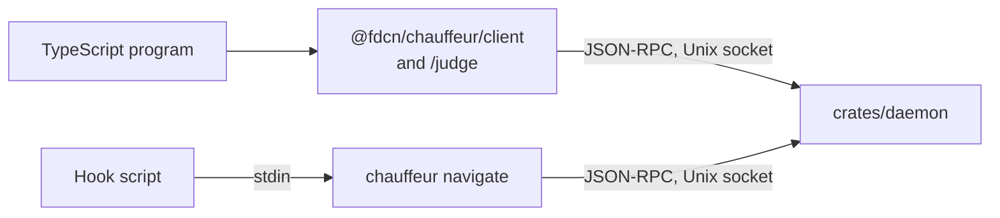
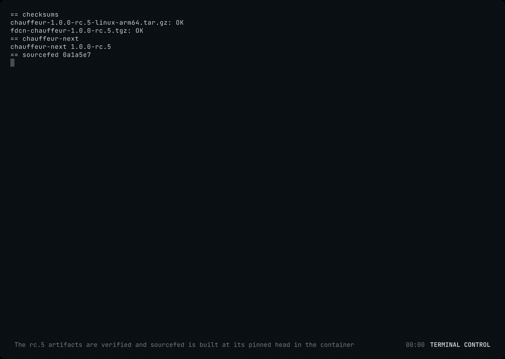
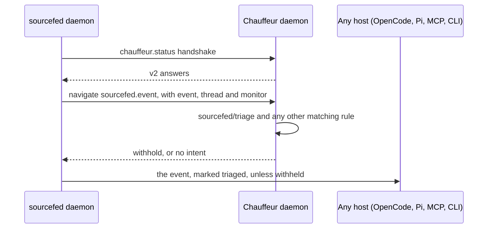
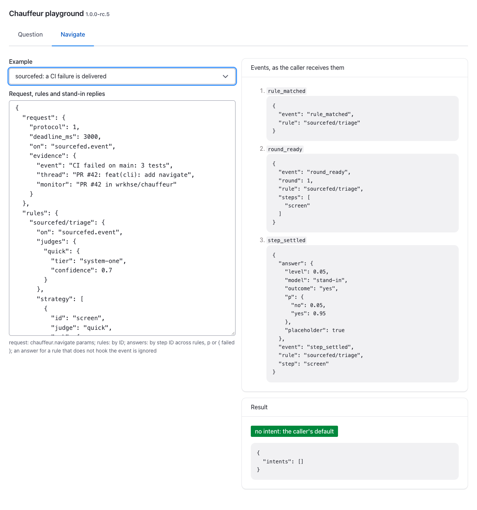

# Slice 2: sourcefed triage

**Status:** Implemented, released as `chauffeur-next` `1.0.0-rc.5`, with the
daemon's socket and rule sources, the `@fdcn/chauffeur` client and
`chauffeur navigate` bindings, the playground's _Navigate_ tab, and
sourcefed's triage running against the release.

**You can:** let sourcefed ask Chauffeur before it queues each event, so
OpenCode, Pi, MCP and the CLI receive the same filtered stream. sourcefed's
daemon navigates `sourcefed.event` once a v2 daemon answers its handshake,
and marks the events v2 triaged; its installer adds `sourcefed/triage` with
the System One screen, and its OpenCode adapter keeps calling v1's
`chauffeur.gate` for the events that are not marked.

A caller sends an event or an inline strategy, with its evidence and a
deadline, and receives the events and the intents or verdict. It sends data,
never callbacks or code. This slice adds caller events, intents, the
integration and project rule sources, admission and cancellation, and the
bindings: the TypeScript client and `/judge`, and `chauffeur navigate`.



## Recording

One `termctrl` session runs the container-only proof in `scripts/e2e/`. It
checks both rc.5 tarballs by sha256, installs the daemon as Homebrew lays it
out, and checks that it reports `chauffeur-next 1.0.0-rc.5`. sourcefed is
cloned at PR #29's merge commit `0a1a5e7` and built, and the twelve recorded
events go through
`new ChauffeurTriage({ connect: chauffeurNavigators(connect) })` against the
shipped daemon. Each case prints its intents, and the run ends
`12 cases: 6 withheld, 6 delivered; every verdict matches the fixture`.

The judge is a placeholder, so the proof is the shipped client, daemon, rule
loading and verdict path agreeing with sourcefed's triage, not a real model's
answers. The invocation is in
[`scripts/e2e/README.md`](../../../scripts/e2e/README.md).



## Wire contract

A `chauffeur.navigate` request, `chauffeur.event` notifications, then the
result, as JSON-RPC 2.0, one message per line, over the daemon's Unix socket.
A request with an `id` gets a result or an error; a message without one is a
notification. `chauffeur navigate` reads the request's `params` on stdin and
prints the messages it receives:

```sh
chauffeur navigate <<'EOF'
{ "protocol": 1, "deadline_ms": 3000, "on": "sourcefed.event",
  "evidence": { "event": "…", "thread": "…" } }
EOF
```

It prints one JSON-RPC message per line: `event` notifications as the run
goes, then the result. Their contents, in order:

```text
event   rule_matched  { "rule": "sourcefed/triage" }
event   round_ready   { "rule": "sourcefed/triage", "round": 1, "steps": ["screen"] }
event   step_settled  { "rule": "sourcefed/triage", "step": "screen",
                        "answer": { "outcome": "no", … } }
result  intents       [{ "rule": "sourcefed/triage", "withhold": "event" }]
```

Each `chauffeur.event` carries, in its `params`, the `id` of the call that
produced it, so two calls on one connection stay apart. A rule's
`rule_matched` is sent as its run starts. A rule cut short after it starts
settles each of its steps with `failed` naming why: `deadline`,
`cancelled`, `busy`, `stopped` or `refused`.

A rejection is a JSON-RPC error whose `data.reason` names it: `invalid`,
`limit_exceeded`, `judge_unavailable`, `busy`, `deadline`,
`unsupported_protocol` or `cancelled`. The code is `-32602` for what the
caller sent, `-32000` for what the daemon could not serve, and `-32800` for a
call its caller cancelled. `limit_exceeded` adds `limit` and `max`, and
`unsupported_protocol` adds `accepted`:

```json
{
  "jsonrpc": "2.0",
  "id": 1,
  "error": {
    "code": -32602,
    "message": "evidence is over 256 KiB",
    "data": { "reason": "limit_exceeded", "limit": "evidence_bytes", "max": 262144 }
  }
}
```

A request with `strategy` in place of `on` runs only that strategy, with its
own `judges` and `asks`, and ends with `{"verdict": {…}}`, each step's
result by step ID. `$CHAUFFEUR_SOCKET` defaults to `chauffeur/daemon.sock` in
the user's runtime directory: `$XDG_RUNTIME_DIR`, or `$TMPDIR` on macOS.

- **Answers and failures** are distinct: a step settles to
  `{"answer": {"outcome", "p", "level", "model", "placeholder"}}` or
  `{"failed": "<reason>"}`. Probabilities and the level have at most three
  decimals, and `placeholder` marks a stand-in's answer.
- **Intents** carry the rule that produced them, and come in the order the
  rules load. A rule's intents are dropped if its strategy misses the
  deadline; other rules' intents still return. No intent is the caller's
  default: a rule whose `then` meets nothing, whose judges fail or that
  misses the deadline returns none, so sourcefed delivers.
- **Evidence** is named once per navigation and referenced by steps, so a
  batched provider call carries each block once. Each block is also a field
  of the event rules match, which `on` names.
- **Stateless:** a navigation needs no agent session or history. The caller
  sends the evidence it wants considered, and the only state kept between
  navigations is a rule's cooldown.
- **Cancellation:** `$/cancelRequest` with a call's `id` cancels it, and a
  connection that closes cancels every call it carried.
- **Versioning:** `protocol` is a required whole number; the daemon answers
  one it does not accept with `unsupported_protocol` and the versions it
  accepts, and each binding reports it as `unavailable`. Any other value,
  such as `"1"`, `1.5` or `-1`, is `invalid`.
- **Project:** a request may name the `project` it works in, as the absolute
  path of at most 4096 bytes, the `project_bytes` limit; a relative path, or
  one that is not text, is `invalid`. The daemon then reads that project's
  `.chauffeur/rules/` too, bounded and cached, and applies the project's
  System Two allowance. The project is canonicalized once, and that one path
  serves the walk, the allowance, the cooldown key and the audit line, so a
  symlinked worktree, or `/var` and `/private/var` spellings, is one project.
  A request whose project cannot be resolved is refused, with a message that
  quotes the path and says why; it is not treated as having no rules.
- **Inline trust:** an inline strategy carries its caller's user-level trust,
  so a judge that names a `model`, and a `person` judge, are allowed. Inline
  System Two, a judge whose tier is `system-two` or a step naming
  `system-two`, runs only when the request names a `project` that the
  user-level `projects.json` in Chauffeur's config folder lists. Without a
  `project` the request is refused at parse with `judge_unavailable`; a
  project the list does not name is refused by the daemon with
  `judge_unavailable` too. An inline strategy whose judge has no model to ask
  is `judge_unavailable` before it runs. No System Two format ships yet.
- **Nulls:** a JSON null anywhere in `params` is `invalid`; a field with no
  value is left out.
- **Limits**, checked before admission: a request line of 1 MiB; a `project`
  of at most 4096 bytes; 32 steps per strategy; 32 judges and 32 asks per
  strategy; 64 outcomes per question, and 64 bars in a per-outcome
  confidence; 64 evidence blocks, 64 candidates, and 64 blocks named by one
  ask; 256 KiB of evidence and candidates together, names included; 16 KiB
  in each text a strategy names: instructions, descriptions, outcome values,
  step IDs, judge and ask names, evidence names, a judge's `model`, and an
  outcome key in a per-outcome confidence; a 30 s deadline. Each rejection
  names its limit.
- **In the next release candidate:** a strategy holds at most 16 steps; a
  step's `after` or `after_any` list holds at most 64 needs, the `needs`
  limit, and a need's `when` at most 66 values, `when_outcomes`. A step the
  run skips sends no event, since protocol 1 has none for it; the audit log
  shows it.

An intent names only its rule's ID, so a project's `team/review` reads like
an integration's rule of that ID. Whether an intent should carry its source is
open in [the plugin runtime](https://github.com/wrkhse/chauffeur/issues/44).

The request and result are defined once, in
`crates/protocol/schema/navigate.json`, and every binding forwards them to
the socket unchanged. The schema's fixtures run in the protocol crate's tests
and in each binding's.

- `@fdcn/chauffeur/client`, for TypeScript programs: `navigate(request)` over
  the socket.
- `chauffeur navigate`, for hook scripts, Git hooks and CI on the same
  machine: one request on stdin, the JSON-RPC messages on stdout.
- `crates/protocol`, for Rust programs: the same types the daemon uses.

## What it builds

### Requests, intents and limits

The `navigate` request and its intents, the limits above, and the one
`navigate` schema with the valid and invalid requests every binding's tests
replay.

Files: `crates/protocol/src/request.rs`, `intent.rs`, `limits.rs`,
`progress.rs`, `rule/strategy.rs`, `schema/navigate.json`,
`fixtures/navigate.json`

```rust
let request = Navigate::parse(&params)?; // Err(Rejection) is the JSON-RPC error

match request.target() {
    Target::On(event) => { /* every rule that hooks request.event() answers */ }
    Target::Strategy(strategy) => { /* only this strategy runs */ }
}
```

Structure:

`Navigate::parse` checks a request's `params` in order: the protocol first,
so a newer caller's fields read as `unsupported_protocol`, then nulls, the
fields, the limits, and an inline strategy. A request without `deadline_ms`
gets `DEFAULT_DEADLINE`, 3 seconds, and one of 0 is `invalid`. An empty `on`
is refused, as are `judges` or `asks` beside `on`, and an inline step naming
evidence the request does not send. `event` is what rules match: named by
`on`, with each evidence block as a field.

```rust
pub const PROTOCOLS: [u64; 1];
pub const DEFAULT_DEADLINE: Duration;

pub struct Navigate { … }

impl Navigate {
    pub fn parse(params: &Value) -> Result<Self, Rejection>;
    pub const fn deadline(&self) -> Duration;
    pub fn project(&self) -> Option<&Path>;
    pub fn evidence(&self) -> &[(String, String)];
    pub fn candidates(&self) -> &[(String, String)];
    pub const fn target(&self) -> &Target;
    pub fn into_target(self) -> Target;
    pub fn event(&self) -> Option<Event>;
}

pub enum Target {
    On(String),
    Strategy(Strategy),
}
```

A rejection is the JSON-RPC error a binding receives; `to_error` builds it
with the code and `data` above.

```rust
pub enum Rejection {
    Invalid(String),
    LimitExceeded(Exceeded),
    UnsupportedProtocol,
    Busy,
    Deadline,
    JudgeUnavailable(String),
    Cancelled,
}

impl Rejection {
    pub const fn reason(&self) -> &'static str;
    pub fn to_error(&self) -> Value;
}

impl From<Exceeded> for Rejection {}
impl From<RuleError> for Rejection {}
```

Each limit has its wire name, such as `evidence_bytes`, and its maximum.
Rule files are held to the same limits as requests, as `RuleError::Limit`.
`Needs` and `WhenOutcomes` arrive in the next release candidate.

```rust
pub enum Limit {
    Steps,
    Outcomes,
    EvidenceBlocks,
    Candidates,
    EvidenceBytes,
    Deadline,
    Judges,
    Asks,
    Needs,
    WhenOutcomes,
    TextBytes,
    ProjectBytes,
}

impl Limit {
    pub const ALL: [Self; 12];
    pub const fn name(self) -> &'static str;
    pub const fn max(self) -> u64;
    pub const fn check(self, count: u64) -> Result<(), Exceeded>;
}

pub struct Exceeded {
    pub limit: Limit,
    pub count: u64,
}
```

An intent is one object on the wire, `rule` and the intent itself.
`from_json` refuses an object with no `rule` or more than one intent, and a
rule file may not name a `then` entry `rule`. `progress` builds each
`chauffeur.event`'s params and the verdict by step.

```rust
pub struct Intent { … }

impl Intent {
    pub fn new(rule: &str, then: &Then) -> Self;
    pub fn from_json(value: &Value) -> Option<Self>;
    pub fn to_json(&self) -> Value;
}

pub mod progress {
    pub fn rule_matched(rule: &str) -> Value;
    pub fn run_events(rule: Option<&str>, events: &[RunEvent<Answer>]) -> Vec<Value>;
    pub fn settled(outcome: &Outcome<Answer>) -> Value;
    pub fn settled_failed(rule: &str, step: &str, failed: &str) -> Value;
    pub fn verdict(verdict: &Verdict<Answer>) -> Value;
}
```

The fixtures are one file of cases, each with `params` and either
`"expect": "on"` or `"strategy"`, or a `reject` with its `reason` and
`limit`. A case with `fill` has `text` repeated `times` put at the JSON
pointer `at` before it is sent. A rejected case the schema cannot see as
rejected, such as one over a byte limit, carries `"schema": "accepts"`, and
one `Navigate::parse` accepts because the daemon refuses it later carries
`"parsed": "accepts"`.

```json
{
  "name": "evidence over 256 KiB",
  "params": { "protocol": 1, "on": "sourcefed.event", "evidence": { "log": "" } },
  "fill": [{ "at": "/evidence/log", "text": "€", "times": 87381 }],
  "reject": { "reason": "limit_exceeded", "limit": "evidence_bytes" },
  "schema": "accepts"
}
```

Verified by:

- Round-trip and rejection cases for every limit and malformed field,
  including a JSON null in `params`, duplicate outcomes, reserved outcome
  names and a per-outcome confidence that misses an outcome:
  `crates/protocol/tests/navigate.rs` replays the fixture cases and checks
  that every limit has one, at and over it, that bytes count as UTF-8 across
  evidence, candidates and every named text, and that a relative `project` is
  refused. Each accepted case keeps its deadline, evidence, candidates, step
  IDs and judges.
- The same test file checks every case against `schema/navigate.json`
  with the `jsonschema` crate: accepted cases, and rejected ones tagged
  `"schema": "accepts"`, fit it; every other rejected case does not.
- Every shipped rule file loads within the limits, and one over 1 MiB is
  refused with its path.

### Admission and running

One permit per navigation, shared by the caller and every job, held until
both the caller releases it and its last worker is free, with per-source and
global capacity; a bounded worker pool per source; the deadline and
cancellation checked before each round; late results discarded.

Files: `crates/runtime/src/admission.rs`, `run/`, `proofs.rs`

```rust
// Err(Busy) while the source's share or the capacity is in use.
let permit = admission.admit(Source::Integration)?;
let cancel = Cancel::new(Source::Integration).admitted(permit);

let ran = run_strategy(&context, &strategy, &evidence, deadline, &cancel);
```

Structure:

The daemon admits each call for its source: `Harness` for `chauffeur.emit`,
`Integration` for `chauffeur.navigate`. `Capacity::DAEMON` allows 16 at
once, 8 from each source, so a flood from one source leaves the other its
share. A refused call never waits in a queue, and names the source that asked
and the limit it reached. A cancelled or late job keeps its permit until its
worker finishes, so cancelling cannot refill a share with work still running.
The socket belongs to the user: shares protect against accidental floods, not
hostile local callers, who can choose either method.

```rust
pub enum Source {
    Harness,
    Integration,
}

pub struct Capacity {
    pub global: usize,
    pub per_source: usize,
}

impl Capacity {
    pub const DAEMON: Self;
}

pub struct Admission { … }

impl Admission {
    pub fn new(capacity: Capacity) -> Self;
    pub fn admit(&self, source: Source) -> Result<Permit, Busy>;
    pub fn in_use(&self) -> Ledger;
}

pub struct Permit { … }

impl Permit {
    pub fn source(&self) -> Source;
}

impl Clone for Permit {}

pub struct Busy {
    pub from: Source,
    pub limit: Limit,
}

pub enum Limit {
    Share(usize),
    Global(usize),
}
```

`Ledger` is admission's state without its lock, so Kani can check every
sequence of takes and gives. `give` for a source holding nothing changes
nothing.

```rust
pub struct Ledger { … }

impl Ledger {
    pub const fn new(capacity: Capacity) -> Self;
    pub fn take(&mut self, source: Source) -> Result<(), Busy>;
    pub fn give(&mut self, source: Source);
    pub fn held(&self, source: Source) -> usize;
    pub const fn total(&self) -> usize;
}
```

The run, its pool, waiting and the 4,096-event log are in
[`crates/runtime/src/run/`](../../../crates/runtime/src/run/README.md).

Verified by:

- Miri over `crates/runtime/tests/admission.rs`, which touches no file or
  network: a deadline, a cancel during the wait and before the start, a
  cancelled wait that keeps its slot until its job finishes, a panicking job
  refused with its worker and slot freed, a late result, a full pool, a
  permit given back when its thread panics, a share and the capacity in use,
  and a flood: 81 submissions with capacity 8 admit 8 and refuse 73 as
  `Busy`.
- Kani, in `crates/runtime/src/proofs.rs`: the ledger stays within its
  capacity over any six takes and gives; the last copy of a permit gives the
  slot back exactly once, whichever copy drops first; the event log never
  exceeds its bound.
- `crates/runtime/tests/run.rs`: an inline strategy settles over the
  request's evidence, and a cancelled run returns at once while its judge is
  still being asked; 32 cancelled integration runs, 8 admitted and 24
  refused admission, fill all 32 integration workers, so the next is
  refused while a harness strategy still settles.

### The daemon's socket and rule sources

Several calls per connection, at most 16 open and at most 4 of them
`chauffeur.navigate`; a fifth navigation is refused at once with `busy`,
which keeps the integration share free for other connections.
`$/cancelRequest`, and a close, cancels what the connection carried.
`--models FILE` for tests. A navigation matches rules from four sources,
loaded rules first in their order, then the request's project's in ID order,
and runs them concurrently.

Files: `crates/daemon/src/socket.rs`, `rpc.rs`, `route/navigate.rs`,
`project.rs`, `state.rs`

```text
distribution/rules/                     shipped
~/.config/chauffeur/rules/sourcefed/    an integration's, installed by it
~/.config/chauffeur/rules/              the user's
.chauffeur/rules/                       a project's: no models, no person,
                                        System Two only where allowed
```

Structure: [`chauffeur daemon`](../../cli/daemon.md) for the connection,
`projects.json` and a project's rules, and
[`crates/daemon/src/route/`](../../../crates/daemon/src/route/README.md) for
routing, cooldowns and the audit line

Verified by:

- `crates/daemon/tests/navigate.rs`, through the real socket:
  - noise is withheld, with `rule_matched`, `round_ready` and
    `step_settled` before the intents;
  - an unhooked event returns no intents and no events;
  - an inline strategy returns its verdict;
  - rejections by reason: `unsupported_protocol`, `limit_exceeded`,
    `judge_unavailable` and `deadline`;
  - an inline System Two strategy for a project `projects.json` does not
    list is `judge_unavailable`, and the message names the file; for a
    project it lists, the reason is the judge's missing model instead;
  - a `projects.json` naming a relative path is refused, and the daemon
    does not start;
  - a fast call on a connection is not held up by a slow one;
  - `$/cancelRequest` is answered as `cancelled` within a second;
  - a second call with an open ID is refused and the first still answers;
  - a `chauffeur.navigate` notification runs nothing, and so does a
    `chauffeur.emit` notification, which is answered with no reply;
  - malformed ids are `invalid` with `-32600`, and a string id is
    preserved;
  - closing a connection cancels its 4 calls and frees their places;
  - 10 navigations at once from one source: 4 answered, 6 `busy`;
  - one client at its navigation share leaves a place for another.
- Each of the four sources loads; a request's `project` adds its rules, read
  within bounds and cached.
- A fifth open navigation on one connection is `busy` while another
  connection is still served.
- A project rule naming System Two in a project that `projects.json` does
  not list, one naming a `model`, and one using the `person` tier, are
  refused.
- An inline strategy naming `system-two` is `judge_unavailable` without a
  `project` at parse, and from the daemon when the list does not name the
  project.
- Two matching rules both return their intents; a rule that misses the
  deadline drops only its own intents, and settles each of its steps with
  `failed` for the deadline.
- A project rule returns its intents alongside the integration rule's, with
  its ID relative to its folder; one whose ID a loaded rule has is skipped
  with a line saying so; adding, deleting or renaming a project rule file
  changes the next navigation's rules; and a project's `models.json` is
  never read, even when it maps `system-two` to a placeholder that would
  answer.
- The project cache keeps at most 32 projects and forgets the least recently
  used; an entry is reused only for the load and signature that built it, so
  emptying `projects.json` stops a listed project's System Two rule on the
  next navigation.
- A rule file or folder that is a symlink elsewhere, and a
  `.chauffeur/rules/` that resolves outside the project, load nothing; a rule
  file replaced after the walk, and a folder whose device or inode changed
  before or while it is listed, are refused; a project folder over 4,096
  entries, 256 folders, 512 rule files or 8 MiB of rule files is refused, in
  `crates/daemon/src/project.rs`'s tests.
- Two projects' rules with the same ID do not share a cooldown, and a
  project reached through a symlink runs its rule, with the canonical path in
  its audit entry, and its cooldown holds across both spellings: one nudge,
  not two.

### The bindings

`chauffeur navigate` reads one request on stdin and prints the JSON-RPC
messages on stdout, exiting 0 with intents or a verdict, 1 when rejected and
2 when no daemon answers. `@fdcn/chauffeur/client` sends `navigate` over the
socket and closes on abort; `/judge` holds `ask`, `judge` and `noul`, with
results typed from their questions. Each prerelease carries the client as
`fdcn-chauffeur-<version>.tgz`, and integrations pin its asset URL.

Files: `crates/cli/src/navigate.rs`, `packages/chauffeur/src/client/`,
`packages/chauffeur/src/judge/`

```ts
import { ask, judge, noul } from "@fdcn/chauffeur/judge"

const quick = judge({ tier: "system-one", confidence: 0.7 })

const done = await ask(noul("Is the migration finished?"), {
  judge: quick,
  evidence: { log }
})

if (done.ok && done.outcome === "yes") {
  /* "yes" | "no" | "unsure" */
}
```

Structure: [`@fdcn/chauffeur`](../../../packages/chauffeur/README.md) and
[`chauffeur navigate`](../../cli/navigate.md)

Verified by:

- The client, `/judge` and `chauffeur navigate` accept and reject every
  fixture identically and return the same verdicts.
- Aborting any caller cancels the navigation; an unsupported protocol reports
  as `unavailable`.
- `ask`'s result types reject impossible outcomes at compile time:
  `packages/chauffeur/test/types.test.ts` holds `@ts-expect-error` lines the
  typecheck fails on if they compile.
- `packages/chauffeur/test/daemon.test.ts`, in CI against the built daemon:
  the client and `chauffeur navigate` accept and reject all 51 fixtures alike,
  but for the one without `protocol`, which the client always sends;
  `ask`, the client and `chauffeur navigate` give one verdict; an abort from
  each is a cancelled run in the audit log. Every accepted fixture fits the
  schema.
- `packages/chauffeur/test/client.test.ts` and `judge.test.ts`, against a
  stand-in daemon: events, rejections, no daemon, a hang-up, a silent daemon,
  aborts on both connections, and reconnecting after a restart.
- `crates/cli/tests/navigate.rs` runs `chauffeur navigate` against a daemon
  on a test thread: an event prints its events then the intents, every
  fixture exits 0, 1 or 2 with its reason and limit, no daemon exits 2, and
  stdin that is not JSON exits 1.

### The navigate tab

The playground's _Navigate_ tab checks a request as the daemon does and runs
it against rule files, each step answered by a stand-in reply, so a rule's
triage can be tried in a browser with no daemon or model.

Files: `playground/wasm/src/navigate.rs`,
`playground/wasm/tests/navigate.rs`,
`playground/src/features/navigate.ts`,
`playground/src/features/navigate-examples.json`

```json
{
  "request": {
    "protocol": 1,
    "on": "sourcefed.event",
    "evidence": { "event": "thanks, looks good 👍" }
  },
  "rules": { "sourcefed/triage": { "on": "sourcefed.event", "…": "…" } },
  "answers": { "screen": { "yes": 0.06, "no": 0.94 } }
}
```

Structure: [`playground/`](../../../playground/README.md), which says what
the tab does not model

Verified by:

- `playground/wasm/tests/navigate.rs`: noise withheld after the run's
  events; every `rule_matched` before any run, in rule ID order; distinct
  steps receive their own replies; an invalid answer names its step and the
  expected shape or failure names; an answer keyed to no step is an error;
  unsure, a failure and no reply give no intent; an inline verdict; a
  refused rule; a rejection over a limit; every browser example fits the
  schema and gives its expected result.
- The unit test in `playground/wasm/src/navigate.rs`: a rule whose plan
  cannot run is refused and the others still run.
- The tab in Chrome, from `vite preview` of the release build: each example
  shows its events, then withhold, no intent, a verdict, or the
  `unsupported_protocol` rejection.

### sourcefed

sourcefed's daemon navigates `sourcefed.event` before it queues an event for
a target, and queues it unless an intent withholds it. With no Chauffeur, an
error or no answer, sourcefed delivers.



It asks v2 only when a v2 daemon answers its `chauffeur.status` handshake. It
looks for `$CHAUFFEUR_SOCKET` alone when it is set: an explicit override does
not fall back. Otherwise it tries `chauffeur`'s socket, then
`chauffeur-next`'s. The OpenCode bridge keeps calling v1's `chauffeur.gate`
for events that are not marked triaged. Its installer puts
`sourcefed/triage` under the v2 installation's `rules/sourcefed/`, never in
v1's `~/.config/chauffeur/rules`.

Files, in sourcefed: its daemon, its installer, `adapters/opencode/bridge.ts`

```ts
const chauffeur = connect() // kept for the daemon's lifetime

const { intents } = await chauffeur.navigate({
  on: "sourcefed.event",
  evidence: { event, thread, monitor }
})

if (!intents.some((intent) => intent.withhold === "event")) {
  queue(target, event)
}
```

The evidence it sends, and how to tune the rule, are in
[sourcefed](../../integrations/sourcefed.md).

Verified by the end-to-end checks below. The sourcefed side is tracked in
wrkhse/sourcefed#27.

## End to end

- sourcefed, for real: v1's 12 labelled events give the same deliveries;
  events reaching OpenCode, Pi and the CLI are filtered alike; with Chauffeur
  stopped, sourcefed delivers.
- With only v1's daemon running, sourcefed's `chauffeur.status` handshake
  goes unanswered, no event is marked triaged, and the OpenCode bridge's
  `chauffeur.gate` filters as before.

The 12 labelled events and v1's recorded gate replies are in
`crates/protocol/fixtures/sourcefed-events.json` and
`sourcefed-events.v1.json`, checked by
`crates/protocol/tests/sourcefed_events.rs`.

### Playground

The v2 playground is built with `bun run build` and served from a throwaway
nginx container publishing `127.0.0.1:4173`: nothing is served from the host.

A real Chromium, through agent-browser, opens the _Navigate_ tab with its
shipped example `sourcefed: a CI failure is delivered` run as it stands, then
the first example, `sourcefed: noise is withheld`.

The CI failure shows `rule_matched`, `round_ready` with `steps ["screen"]`, and
`step_settled` with `answer {outcome "yes", level 0.05, model "stand-in"}`, then
the result `{"intents": []}` under the "no intent: the caller's default" badge.
The noise example shows the withhold intent. The tab needs no daemon: its
WebAssembly build runs the rule against the stand-in replies typed into the tab.


