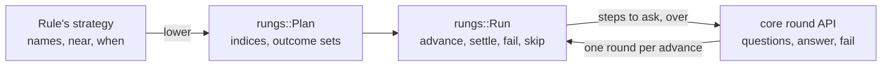

# Slice 3: Escalation from Jev to GLiDE

**Status:** In progress: `after` and rounds in core, and lowering rules to
plans, are built; SubQ and GLiDE, image evidence, the `student` format, the
rest for a failing model, `chauffeur strategy` and the playground follow.

**You can:** have the commit nudge and `sourcefed/triage` ask GLiDE only when
Jev's answer is near the bar the rule acts on, or Jev fails, see each
strategy as a tree with `chauffeur strategy show`, and step through it in the
playground's Strategy tab. An iPhone screen check reaches Jev with its
screenshot, and a jev-distill student answers before Jev.

This slice adds strategies with more than one step: a step's `after` names
the earlier steps it waits for and the outcomes it needs. The step machine
underneath is [rungs](https://github.com/wrkhse/rungs/issues/1), shared
with atelier. It also adds image evidence, the `student` format, and a tier
that rests a failed model for 60 seconds before asking it again.

## What it builds

### `after` and rounds in core

A step's `after` names the earlier steps it waits for and the outcomes it
needs. Core validates a plan before any judge is asked, and drives it through
the round API: `questions`, `answer` and `fail`.



Core turns a plan's named steps into a `rungs::Plan` and keeps a `rungs::Run`
for each run. rungs decides which steps start, which are skipped and when the
run is over. Core keeps what rungs knows nothing about:

| Core keeps      | How                                                                                                                                                                                                                                                                |
| --------------- | ------------------------------------------------------------------------------------------------------------------------------------------------------------------------------------------------------------------------------------------------------------------ |
| Names           | Step IDs become indices; events and verdicts carry the names                                                                                                                                                                                                       |
| `near`          | An answer settles as one outcome index: the answer times 2^k, plus which of the step's k `near` needs matched; each need lists the indices it accepts; probabilities, bars and margins are whole thousandths, so a P of 0.85 lies exactly within 0.15 of a 0.7 bar |
| `when`          | The listed outcomes, `failed` as `Outcome::FAILED`, join the need's outcome set                                                                                                                                                                                    |
| The deadline    | With less than 500 ms left before the end, core skips every Pending step, so no escalation starts                                                                                                                                                                  |
| Batches         | A reply is settled on a copy of the run, kept only when every step in it settles                                                                                                                                                                                   |
| Failure reasons | `Failure::Timeout` and the rest stay in the events; rungs only records `FAILED`                                                                                                                                                                                    |

Core records skipped steps. `navigate` remains on protocol 1 and omits skipped
steps from both wire events and the verdict: rc.5 clients reject unknown
events. A separate design covers future wire skips; audit and `strategy show`
report skips in this slice.

A string need is `Need::settled`, an object need `Need::outcome`, and `all`
and `any` are a step's `after` and `after_any`. Every step has one attempt.

**Breaking:** a strategy has at most 16 steps, as many as rungs holds. This
differs on the wire from 1.0.0-rc.5, which allowed 32: a `navigate` request
or rule file with 17 or more steps is refused with `limit_exceeded` naming
`steps`, and the navigate schema's strategy `maxItems` is 16.

Files: `crates/core/src/plan/need.rs`, `crates/core/src/plan/near.rs`,
`crates/core/src/plan/run.rs`, `crates/core/src/plan/reply.rs`,
`crates/core/src/proofs.rs`, `crates/core/tests/scenarios.rs`,
`crates/protocol/src/limits.rs`, `crates/runtime/src/run/{mod,rounds}.rs`,
`crates/runtime/tests/run.rs`, `deny.toml`

```toml
# crates/core/Cargo.toml
rungs = { git = "https://github.com/wrkhse/rungs", tag = "v0.1.0" }
```

```json
"strategy": [
  { "id": "fast", "judge": "jev", "ask": "nonconventional" },
  { "id": "sure", "judge": "glide", "ask": "nonconventional",
    "after": [{ "step": "fast", "near": 0.15, "when": ["failed"] }] }
]
```

A need with `near` matches when the step's P for an outcome the rule acts on,
in its `then` or a later need, lies within that margin of the outcome's bar.
The commit nudge acts on `yes` at 0.7, so Jev's `yes` at 0.8 goes to GLiDE,
and its `no` at 0.75, a P(yes) of 0.25, does not. `when` adds the outcomes
that also match, here a failure.

Runtime drives each round and gives its judges that round's end. Round 1's
judges end at the caller's deadline plus 100 ms grace: the caller's wait
answers `Deadline` first, and the worker's HTTP call stops just after, freeing
its slot. A single-round run with a short deadline still asks its models. A
round after the first ends 1 s before the deadline, so the answers in hand
return in time; core starts such a round only with 500 ms left before that
end, and skips its steps otherwise. Between rounds runtime checks
cancellation, then the caller's deadline. Cancellation does not interrupt an
HTTP call already in progress; an admitted run holds its place until the
worker finishes.

The caller's request type implements `Request`, how many values its answer
can settle to, and its answer type implements `Reply`, which value it settled
to and its probability for each outcome in thousandths, so core reads answers
without knowing models.

```rust
let mut running = plan.start(Some(deadline));

// Each round holds the steps whose needs are met.
while let Some(round) = running.questions(Instant::now) {
    // Or running.fail(step, Failure::Timeout).
    running.answer(round.ask(&panel))?;
}

let run = running.finish(); // "sure" is skipped when "fast" said yes or no
```

Verified by scenario tests:

- Escalation, with recorded answers at every tier: `near` asks GLiDE for
  Jev's P(yes) of 0.55 to 0.85 on a 0.7 bar and not for 0.25, and a failure
  listed in `when` asks it too.
- The deadline: core's end is 1 s before it, and an escalation with less
  than 500 ms left before that end is skipped
  (`the_steps_end_one_second_before_the_deadline`,
  `an_escalation_with_less_than_500_ms_left_is_not_started`,
  `an_escalation_with_500_ms_left_starts`). Only a run with a deadline
  reads the clock, and only before a round after the first.
- Runtime's round ends, in `crates/runtime/tests/run.rs` and
  `crates/runtime/src/run/rounds.rs`:
  `a_judge_slower_than_the_deadline_returns_deadline` and
  `a_short_budget_asks_the_model_once_and_its_call_stops_just_after` show
  round 1 asked under a short deadline, the caller answered `Deadline`, and
  the HTTP call stopped just after;
  `the_first_round_ends_after_the_deadline_and_a_later_one_before_it` checks
  both ends; `a_later_round_ends_a_second_before_the_deadline` settles with
  the later step failed as `Deadline`; and
  `a_last_round_answered_after_the_caller_deadline_still_settles` keeps a
  late last answer.
- `after` alone: a string need waits for a skipped step and then runs; an
  object need never matches a skipped step; `Failed` matches only when listed;
  a step with both `all` and `any` runs only when both hold.
- Validation: an empty plan, more than 16 steps, a duplicate ID, `after`
  naming a later or unknown step, an empty `when` list, more `near` needs on
  one step than 126 outcomes hold, and a judge the panel lacks, each rejected
  before any judge is asked.
- The round API: a reply naming an unknown, unasked or repeated step, or
  missing one, returns the unchanged round; each judge answers its share of a
  round in one call; a batch of the wrong length settles as `Failed`.

Core's decision scenarios in `crates/core/tests/scenarios.rs`:

- `a_confident_fast_answer_decides_when_sure_is_skipped`:
  `fast` decides when escalation is skipped.
- `sure_decides_when_fast_is_near_the_bar`:
  `sure` supplies the decision after escalation.
- `a_failed_sure_is_the_decision_for_every_failure_path`:
  an answered failure, `fail`, `fail_round` and finishing an open round
  all preserve `sure`'s failure as the decision.
- `a_later_round_decides_before_a_higher_plan_index`:
  the later round wins over a higher index in the first round.
- `the_higher_plan_index_decides_despite_reversed_replies`:
  plan order breaks ties within a round, regardless of reply order.
- `failure_settlement_order_does_not_change_the_decision`:
  reversing individual failure settlements preserves the decision.
- `a_trailing_skipped_step_does_not_decide`:
  a skipped tail leaves `sure` as the decision.
- `the_decision_step_id_is_reserved`:
  `decision` returns the reserved-ID error; `Decision` is a valid ID.

rungs' own Kani proofs cover the `after` rule: a step waits until every step
it names has finished, starts exactly when its needs hold, is skipped only when
they cannot, and a run never stalls and starts every step within `depth()`
passes. Core's Kani harnesses cover what it adds, over at most three steps and
a small outcome enum:

- `a_near_need_matches_only_within_its_margin`: a `near` need matches exactly
  when a P the rule acts on lies within the margin of its bar, or the outcome
  is in `when`.
- `an_outcome_index_decodes_to_its_answer_and_near_matches`: encoding an
  answer and its `near` matches as one index, then decoding it, gives both
  back.
- `a_reply_settles_all_of_its_steps_or_none`: a rejected reply leaves the
  run unchanged.

### Lowering rules to plans

A rule's named judges, asks and needs become a `chauffeur_core::Plan`.
`Rule::parse` reads the outcomes `then.if` acts on before lowering needs,
then checks the `then` entries against the plan. Judges keep their rule-local
IDs as panel keys: `jev` and `glide` here.

Files: `crates/protocol/src/rule/{mod,file,need,strategy,error,then}.rs`,
`crates/protocol/src/then.rs`, `crates/protocol/src/limits.rs`,
`crates/protocol/schema/navigate.json`, `crates/protocol/tests/needs.rs`,
`crates/protocol/fixtures/navigate.json`, `crates/core/src/lib.rs`,
`crates/core/src/event.rs`, `crates/core/src/plan/error.rs`

```json
{
  "on": "tool.after",
  "judges": {
    "jev": { "tier": "system-one", "model": "jev", "confidence": 0.7 },
    "glide": { "tier": "system-one", "model": "glide", "confidence": 0.7 }
  },
  "asks": {
    "commit": {
      "outcomes": ["yes", "no"],
      "instructions": "Does this commit message break Conventional Commits?"
    }
  },
  "strategy": [
    { "id": "fast", "judge": "jev", "ask": "commit" },
    {
      "id": "sure",
      "judge": "glide",
      "ask": "commit",
      "after": [{ "step": "fast", "near": 0.15, "when": ["failed"] }]
    }
  ],
  "then": [{ "if": { "decision": "yes" }, "withhold": "event" }]
}
```

The need on `fast` lowers to a bar on outcome 0 (`yes`), taken from
`jev`'s confidence. `sure` keeps `glide` as its judge ID.

```rust
let bar = Bar { outcome: 0, at: 700 };

let need = Need::outcome(
    "fast",
    Some(Near::new(150, [bar])),
    Some(vec![When::Failed]),
);
```

Both `after` and `after_any` are arrays of these needs:

- A step ID string waits for that step to finish: settled, failed or skipped.
- An object `{ step, near?, when?, outcome? }` needs `near` or `when`.
  `outcome` comes only with `near`. An object never matches a skipped
  step. `when` lists the target's outcomes, `unsure` or `failed`.
- Every `after` need must hold; at least one `after_any` need must hold
  when that list is nonempty. With both lists, both conditions must hold.

`near` selects the explicit `outcome` when present. Otherwise it selects
the target's real outcomes named by `then.if` for that step or for
`decision`, together with those any later need's `when` names for the
target. `unsure` and `failed` select no bars. It never selects all outcomes
by default, and sharing an ask with another step selects nothing for it.
An inline strategy has no `then`: it names the outcome in `outcome` or
through a later `when`.

Each selected bar comes from the target step's judge, including its
per-outcome confidence. A `near` with no selected outcome, or whose target
judge settles on the likeliest outcome with no bar, is refused when it loads.
Margins run from 0 to 1 and are stored as whole thousandths.

Each needs list holds at most 64 needs, each `when` at most 66 values
(64 outcomes, `unsure`, `failed`), and each text at most 16 KiB.
The loader checks bounds before reading needs and keeps their order and
repeats. Core refuses unknown, same-step or later-step targets, an empty
`when`, and needs whose outcome codes do not fit.

#### The decision

`then.if.decision` reads the answer of the last step that ran. Last means
the greatest pair of (round it opened in, plan order): a later round wins
over a higher plan index in an earlier round, and settlement order never
changes the decision. A skipped step is never the decision; a step that ran
and failed makes a failed decision. With no step run there is none.
Step-scoped `then.if` entries read their own step.

For the example, a confident `fast` answer of `yes` skips `sure`, and
the decision is `fast`'s answer. With `fast` near the bar and `sure`
answering `no`, the decision is `no` and the rule returns no intent.

`Verdict::get(DECISION)` reads that outcome, and `Verdict::decision()`
also returns its step ID. The loader reserves the step ID `decision` in
`strategy.rs`'s `check_bounds`, before needs are lowered and `then` entries
are resolved. It returns `RuleError::Plan` with `PlanError::ReservedStep`:

```text
rule `bad`: step ID `decision` is reserved for the step that decides the run
```

Navigate reports `invalid`; its schema excludes that step ID with
`"not": { "const": "decision" }`.

#### Structure

Core exports `DECISION` from its crate root. These are the decision-related
additions to its verdict API and plan errors:

```rust
pub const DECISION: &str = "decision";

impl<O> Verdict<O> {
    pub fn decision(&self) -> Option<(&str, &Outcome<O>)>;
}

pub enum PlanError {
    ReservedStep(String),
}
```

A step holds its needs as written. The file types keep fields scoped to
the rule loader; `StepFile` is re-exported for inline strategies.

```rust
pub struct StepFile {
    pub(super) id: String,
    pub(super) judge: String,
    pub(super) ask: AskRef,
    pub(super) after: Vec<NeedFile>,
    pub(super) after_any: Vec<NeedFile>,
}

pub(super) enum NeedFile {
    Settled(String),
    Outcome(OutcomeNeedFile),
}

pub(super) struct OutcomeNeedFile {
    pub(super) step: String,
    pub(super) near: Option<f64>,
    pub(super) when: Option<Vec<String>>,
    pub(super) outcome: Option<String>,
}
```

`ActedOn` holds real outcome names read from `then.if`. Rule lowering
passes it to `Strategy::lower`; inline `Strategy::build` supplies empty
metadata. Both resolve judges and asks, lower needs, then call `Plan::new`.

```rust
pub(super) struct ActedOn {
    by_step: BTreeMap<String, BTreeSet<String>>,
}

impl ActedOn {
    pub(super) fn read(then: &[ThenFile]) -> Self;
}

impl Rule {
    pub fn parse(id: &str, text: &str) -> Result<Self, RuleError>;
}

pub struct Strategy {
    judges: BTreeMap<String, JudgeSpec>,
    plan: Plan<Question>,
}

impl Strategy {
    pub(crate) fn build(
        id: &str,
        judges: BTreeMap<String, JudgeFile>,
        asks: &BTreeMap<String, AskFile>,
        strategy: Vec<StepFile>,
    ) -> Result<Self, RuleError>;

    pub(super) fn lower(
        id: &str,
        judges: BTreeMap<String, JudgeFile>,
        asks: &BTreeMap<String, AskFile>,
        strategy: Vec<StepFile>,
        acted_on: &ActedOn,
    ) -> Result<Self, RuleError>;

    pub const fn judges(&self) -> &BTreeMap<String, JudgeSpec>;

    pub const fn plan(&self) -> &Plan<Question>;
}
```

A need error names the rule, the waiting step and its target. These are the
need-related error and limit variants; a bound violation is a
`RuleError::Limit`, or `limit_exceeded` for navigate.

```rust
pub enum RuleError {
    Need {
        rule: String,
        step: String,
        need: String,
        reason: String,
    },
    Limit {
        rule: String,
        source: Exceeded,
    },
}

pub enum Limit {
    Needs,
    WhenOutcomes,
    TextBytes,
}
```

Verified by `crates/protocol/tests/needs.rs`:

- `a_near_need_asks_sure_only_near_the_bar_the_decision_acts_on`:
  only the selected `yes` bar lowers; a confident answer skips `sure`,
  and a near answer opens round 2. Wire events and verdict omit the skip.
- `a_near_need_holds_at_its_margin_and_on_a_listed_failure`:
  P(yes) 0.55 matches a 0.7 bar with margin 0.15; 0.54 and 0.25 do not;
  a listed timeout opens `sure`.
- `the_decision_is_the_answer_of_the_last_step_that_ran`:
  confident `fast` returns `yes`; `sure` answering `no` makes the
  decision `no`; `Verdict::decision()` identifies each deciding step.
- `a_last_step_that_fails_is_the_decision`:
  a failed `sure` is the decision and matches `then.if.decision: failed`.
- `a_step_named_decision_is_refused` and
  `an_inline_step_named_decision_is_invalid`:
  rule and inline loaders return the reserved-ID error.
- `a_then_on_a_step_bars_its_outcome_and_still_returns_on_it`:
  a step-scoped condition selects its bar and reads that step's result.
- `an_inline_near_bars_the_outcome_it_names` and
  `an_inline_near_bars_what_a_later_when_acts_on`:
  explicit outcomes and later `when` values select inline bars.
- `near_takes_each_outcome_bar_from_the_judge_of_the_step_it_waits_on`:
  per-outcome bars come from the target judge.
- Refusal tests cover missing selection, likeliest judges, outcomes the
  target lacks, `outcome` without `near`, invalid margins, and shared
  asks that supply no selection. Core refusal tests cover unknown and later
  targets, empty needs and `when`, duplicate IDs and code capacity.
- `repeated_needs_are_kept_as_written` and
  `a_step_with_after_and_after_any_runs_only_when_both_hold`:
  needs retain order and duplicates, and both lists constrain a step.
- `each_needs_list_holds_64_needs`,
  `a_when_holds_every_outcome_unsure_and_failed` and
  `a_need_text_over_16_kib_is_refused`: each bound accepts its limit
  and refuses one over it.
- `an_outcome_named_skipped_is_a_real_outcome` and
  `a_then_on_the_decision_expects_an_outcome_some_step_has`:
  `skipped` is an ordinary label; decision conditions validate against
  the plan's outcomes.

The navigate fixtures replay the accepted escalation with both lists and
refusals named `a near need with no outcome to bar`,
`a near need on a judge with no confidence`,
`a when naming an outcome its step lacks`, `a need on a later step`,
`an outcome without near`, `65 needs in after`,
`67 values in a need's when`, `a need's step over 16 KiB` and
`a step named decision`.
`tests/navigate.rs` checks both parser and schema results, including cases
whose semantic checks the schema cannot express.

### SubQ, GLiDE and richer questions

`choice` with every outcome's probability, and GLiDE's level-valued `score`,
in the `systemone` format; SubQ and GLiDE shipped beside Jev.

Files: `crates/judges/src/tiers/system_one/`, `distribution/models/subq.json`,
`glide.json`

```json
{
  "outcomes": ["low", "medium", "high"],
  "evidence": ["prompt"],
  "instructions": "How hard is the user's request?"
}
```

```json
{
  "answer": {
    "outcome": "medium",
    "p": { "low": 0.12, "medium": 0.45, "high": 0.43 },
    "level": 1.31
  }
}
```

Verified by:

- `main`'s `judges/{subq,glide}/tests/wire.rs` replayed over loopback.
- Labelled scale questions through `choice` and `score` report which agrees
  with the labels more often.

### Image evidence

Evidence blocks are text or images. An image goes only to a format that
accepts images, and only when a step names it.

Files: `crates/judges/src/evidence/`

```json
{
  "on": "neo.screen-check",
  "evidence": {
    "screenshot": { "image": "iVBORw0KGgo…", "media_type": "image/png" },
    "ocr_text": "Pay ₹250 to Ravi",
    "question": "Is this the payment confirmation for ₹250 to Ravi?"
  }
}
```

Verified by:

- neo's screen check, with a recorded screenshot, reaches Jev with its opt-in
  and reaches no text-only format.

Follow-up: neo asks Jev itself; moving neo's screen check onto Chauffeur is
neo's own change and follows this slice.

### The `student` format

jev-distill's students over its loopback server: the task's labels are the
outcomes, and evidence blocks fill its `state`.

Files: `crates/judges/src/tiers/system_one/student.rs`

```json
{
  "models": {
    "routing-student": {
      "format": "student",
      "endpoint": "http://127.0.0.1:8787",
      "task": "routing"
    }
  }
}
```

Verified by:

- A question whose outcomes differ from the task's labels fails as `invalid`
  with no call; a student's `unsure` hands the step to Jev.

### A rest for a failing model

A model that fails rests for 60 seconds, then is tried again.

Files: `crates/judges/src/tiers/fallback.rs`

```text
13:54:43  jev timed out        → subq answers; jev rests until 13:55:43
13:55:10  jev skipped          → subq answers
13:55:50  jev asked again      → jev answers
```

Verified by:

- A failing first model is skipped until its rest is over, then asked again.

### `chauffeur strategy`

`strategy list`: each loaded rule with its event, steps, and most rounds and
model calls. `strategy show <rule>` and `--file`: the tree, rounds, resolved
models, `after`, confidence, and the maximum rounds and model calls.

Files: `crates/cli/src/strategy.rs`

```text
$ chauffeur strategy show conventional-commits
conventional-commits  on tool.after
└─ fast    system-one:jev    confidence 0.7
   └─ sure system-one:glide  confidence 0.7   after fast is unsure or failed
at most 2 rounds · 2 model calls
```

Verified by:

- `"model": "glide"` without GLiDE configured shows the tier's fallback
  order.
- Kani: `strategy_show_bounds_every_lowered_plan`, a lowered plan has at most
  the rounds `strategy show` reports.

### The playground

The Strategy tab steps through the same tree.

Files: `playground/src/features/strategy.ts`

Verified by:

- The tab steps through each shipped rule's tree in a real browser.

## End to end

- `"model": "glide"` without GLiDE configured runs on the tier's fallback
  order and reports it.
- The escalation runs live against Jev and GLiDE and agrees with `main`'s
  escalation near the bar, `CHAUFFEUR_JUDGE_ESCALATE=glide`, on the same
  cases, reporting answers, rounds, elapsed time and model calls.
